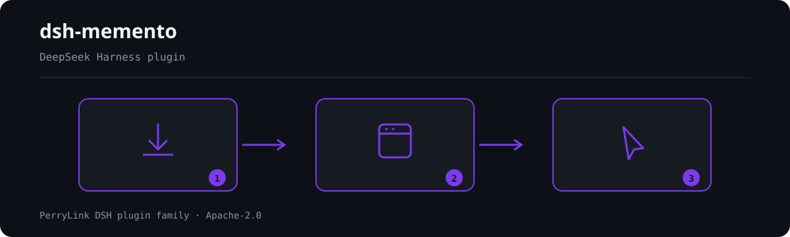

<div align="center">

# dsh-memento
- **1024 商店渠道**：先 `npm i -g dsh1024`，再 `dsh1024 plugin --profile web add dsh-memento`（计入 [deepseek1024.com](https://deepseek1024.com) 安装排行）。

**给 DeepSeek Harness 补上有界、分层、带审批门、可审计的跨会话记忆。**

*一个类型安全的 `ctx.memory` 接缝、模型绕不过去的写入审批门，以及可重建的审计链——来自审批对加插件自有审计表，并把会话日志侧的缺口说出来。*

[](LICENSE)
[](https://gitee.com/perrylink/dsh-memento)
[](https://github.com/topics/dsh-plugin)
[](https://github.com/PerryLink/dsh-plugin-doctor#verified-徽章)
[](https://dsh.market/)
[](#)
[](https://github.com/PerryLink/dsh-memento/actions)
[](https://github.com/PerryLink/dsh-memento/releases)
[](https://www.npmjs.com/package/dsh-memento)
[](https://www.npmjs.com/package/dsh-memento)
[](https://dshfind.com/zh/plugins/PerryLink/dsh-memento?ref=badge)

[English](README.md) · [简体中文](README-zh.md) · [Español](README-es.md) · [Português](README-pt.md) · [हिन्दी](README-hi.md)

```sh
dsh plugin --profile <name> add dsh-memento
```


</div>

---


**📖 生态实测知识库**（实测数据，不是营销）：[插件开发指南 · 选型实测数据 · 维护取舍判据](https://perrylink.github.io/dsh-plugin-guide/)。

<!-- star-cta -->
## Install & uninstall

- **git channel**（最新 `main`）：`dsh plugin --profile web add git+https://github.com/PerryLink/dsh-memento.git`。
- **npm channel**（发布版本）：`dsh plugin --profile web add dsh-memento`。
- **tarball channel**：在本仓库执行 `npm pack`，然后 `dsh plugin --profile web add ./dsh-memento-<version>.tgz`。
- **uninstall**：`dsh plugin --profile web remove dsh-memento`（记忆库与会话日志保留）。

## ⭐ 如果它帮到了你

这个插件是 [DSH 插件家族](https://github.com/PerryLink)的一员（95 个，全部 Apache-2.0）。如果你在用，**给个 star** —— 它不会解锁任何功能，但会让下一个人在搜索里更容易找到它。

*English:* part of a 95 plugin family for DeepSeek Harness. If it is useful, **a star helps the next person find it** — nothing is gated behind it.

## What is dsh-memento?

给 DeepSeek Harness 补上有界、分层、带审批门、可审计的跨会话记忆。

一个类型安全的 `ctx.memory` 接缝、模型绕不过去的写入审批门，以及可重建的审计链——来自审批对加插件自有审计表，并把会话日志侧的缺口说出来。



*工作流概览：安装 → 打开面板 → 操作。下面的示例使用实际命令面。*


*同一次运行，动图版。*

[](https://github.com/PerryLink/dsh-memento/blob/main/docs/assets/dsh-memento-demo.mp4)

*▶ **2 分 23 秒带解说的完整演示**——封面点开后进入 MP4 文件页；若页面上不能播放，就用那里的 *Download raw file*（[MP4，1.87 MB](https://github.com/PerryLink/dsh-memento/blob/main/docs/assets/dsh-memento-demo.mp4) · [直接下载](https://raw.githubusercontent.com/PerryLink/dsh-memento/main/docs/assets/dsh-memento-demo.mp4)）。GitHub 会剥掉 README 里的 `<video>` 标签，所以视频是要打开的文件，而不是内嵌播放。*

## Compatibility

| Surface | Status |
|---|---|
| Harness | DeepSeek Harness `dsh-v0.2.1-alpha.2`（2026-10-12 适配；`0.2.1-alpha.1` 自 2026-10-04 起）：`0.1.7` 线把整条设置注册面（`installSettingsSection` / `SettingsProvider.installSection` / `SettingsNamespace` / `SettingsScope`）换成 live config 表单——表单的 namespace 就是 profile entry id（`memento`），可编辑字段就是标了 `.volatile()` 的那些，被接受的编辑**提交进运行中的插件**而不是重挂它。浏览器半经 `ctx.configForms.get(entryId)` 读同一份表单（`ctx.settingsScope` 服务已删）。浏览器半把 `configForms` 静态写进模块 `inject`——`0.2.x` 宿主按注入式提供该服务，软探测拿不到、只会渲染只读空壳——`settingsScope` 旧分支已删。peer/engines 收窄到 `>=0.2.1-0 <0.3.0`：`0.1.x` 旧宿主上客户端模块（悬浮面板+设置卡片）整体不挂载；宿主半的 `installSection` 形状分派保留为惰性遗留。仍无插件事件注册面——`KNOWN_SESSION_EVENT_TYPES` 不含 `memory/*`，且 `Session.append` 第三参只承载 surface 类型的 `SurfaceIntent`，故审计门保持自适应、行为不变（会在进程内告警一次，并在 `/memory audit` 输出里明示缺口）。类型证据来自三个面：本机 checkout 的已构建类型、`node_modules` 里钉住的已发布线、以及 DOM 库下的浏览器半侧。**已按 `0.2.1-alpha.2` 复核：** 本插件触及的全部宿主面在两个 tag 之间**逐字节相同**（`packages/settings/settings/src/**`、`packages/client/ui-settings/src/**`、`packages/client/ui-slots/src/**`、`packages/client/modules/src/**`、`packages/interaction/user-approval/**`、`vendor/loader/src/**`、`vendor/schemastery/src/**`、`packages/boot/app-boot/src/config-schema/**`），会话格式仍是 v4、没有 v4→v5 迁移，`KNOWN_SESSION_EVENT_TYPES` 只增了一个官方类型——故审计门继续关闭、**代码零改动**。真正变动的是钉住的 dev/test 线（`0.2.1-alpha.2`，以及 `pnpm-workspace.yaml` 里对应的 release-age 白名单）与兼容基线；`npm test`（201 例，含真实 Loader 组合套件）、`typecheck:ci`、覆盖率、制品、一致性套件与五语门在 alpha.2 上全绿。alpha.2 确实新增了 `plugin:<name>/*` 命名空间的 `appendPluginRecord` 写入器，但宿主自己的 `packages/core/session/README.md` 禁止仓外插件调用，且强制的 `plugin:` 前缀无法表达 `memory/*`，故本包不采用。 |
| Node | `^22.19.0 || >=24.0.0` |
| Platforms | Windows / macOS / Linux（纯 host；无原生代码、无网络） |
| Model | 任意 |

## What you get

`dsh-memento` 是能力接缝，不是又一个仓库：一个类型安全的 `ctx.memory` 服务、一个本地 SQLite 提供方（`node:sqlite`，WAL，`0600`，位于 `$DSH_HOME/dsh-memento/memory.db`），以及它的消费方——`memory` 工具与注入系统提示的冻结快照。

- **审批门不可绕过。** 每条写路径（`add` / `replace` / `remove` / `seed`）都被强制经过服务内部的审批 waterfall，而非工具层。`writePolicy: ask | auto | off` 是模型看不见的配置；`replace` / `remove` / `consolidate` 的审批载荷携带将被改动条目的全文，被拒的写同样落一条 `*-denied` 审计行。
- **模型可见 ⟺ 已记录。** 注入的快照逐字进入 `system/message`；每次写都能从 `approval/asked` + `approval/decided` + 插件自有审计表重建。
- **有界且诚实。** 每轨每层硬字符预算（默认 user 2000 / agent 4000）。写满返回结构化错误（用量 + 上限）——绝不截断、绝不自动压缩。
- **审计缺口可见。** `/memory audit` 列出插件审计表，并在会话日志侧未落盘时附一行说明：本宿主不认识 `memory/*` 会话事件类型，而 append 未知类型会让该会话无法再加载，因此写入的审计由 `approval/asked` + `approval/decided` 与插件审计表承担。该提示随门自适应——宿主收录这些类型后自行消失。

两条轨道 × 两个层级 × 按 agent 隔离：`user` 轨（关于用户的事实）与 `agent` 轨（环境事实与约定），各自再分为 `user-global` 与 `workspace` 层，并按 `agentPreset` 隔离。快照在会话首次组装提示时冻结一次，会话中途不再变化。

## Quick start

```sh
dsh plugin --profile web add github:PerryLink/dsh-memento
```

```sh
# 1. install the bundle into your profile
dsh plugin --profile web add github:PerryLink/dsh-memento

# or from npm (published releases)
dsh plugin --profile web add dsh-memento

# 2. restart and verify the row
dsh --profile web --dump-config | grep -A3 'id: memento'
```

### 示例

以下为插件真实入口；安装后调用一个即可。

#### 详细示例

**命令**

~~~sh
memory_stats
~~~

**输入**

~~~json
{"jsonrpc":"2.0","id":7,"method":"tools/call","params":{"name":"memory_stats","arguments":{}}}
~~~

**输出**

~~~text
{
  "total": 3,
  "namespaces": [
    {
      "track": "agent",
      "scope": "user-global",
      "count": 1
    },
    {
      "track": "agent",
      "scope": "workspace",
      "count": 1
    },
    {
      "track": "user",
      "scope": "workspace",
      "count": 1
    }
  ]
}
~~~

*来源 `test/mcp.test.mjs:108-118 (fixture seed at 21-27); README.md:160-176`*

#### 失败分支

**输入**

~~~text
{"jsonrpc":"2.0","id":10,"method":"tools/call","params":{"name":"memory_search","arguments":{}}}
~~~

**输出**

~~~text
{"jsonrpc":"2.0","id":10,"result":{"content":[{"type":"text","text":"invalid arguments: query must be a non-empty string"}],"isError":true}}
~~~

*来源 `plugins/dsh-memento/lib/mcp.mjs:188; plugins/dsh-memento/test/mcp.test.mjs:126-127; reproduced via plugins/dsh-memento/bin/mcp-server.mjs`*

#### 简短示例

- `/memory`

## Configuration

所有可调项均为 Schemastery `Config` 字段（可在 cordis.yml 中修改）。非法值在加载期响亮失败。在 `memento` 行下覆盖。

**设置面板。** `0.1.7` 线上插件自己的 `Config` **就是**它的设置页：表单的 namespace 是 profile entry id（`memento`，即本 bundle 那一行的 `id:`），可编辑字段恰好是插件标了 `.volatile()` 的那些（下表除 `enabled` 外的每个键），被接受的编辑合并进 profile 的插件行并提交进运行中的插件——无需改文件、无需重启。几乎全部即时生效（写策略、语言、预算、各上限、提案、面板；`dbPath` / `auditRetentionDays` 经重开 store 生效；`retrieval.vector` 经重装检索器生效）；插件在加载期注册的面（`snapshotOrder`、工具描述文案）在重载后跟随，页面为这些字段标了记号。数值下限同时写在 schema 里，越界编辑在**写入路径**即被拒绝，不会留下一个用不了的配置。旧线（`0.1.2-rc.1`、`0.1.5-alpha.1`、`0.1.6-0`）上同一张卡片编辑 `dsh-memento` 设置 namespace，行为与从前一致；设置服务完全缺失时一切回退组合配置。悬浮窗按钮可在同一页面隐藏（`panel.enabled`）。

| Key | Default | Meaning |
|---|---|---|
| `enabled` | `true` | 总开关；`false` 移除服务、工具、快照、命令、面板与 answerer（设置页不可编辑——禁用的插件没有设置项） |
| `panel.enabled` | `true` | 显示 Web 面板悬浮按钮；在设置页保存 `false` 后立即隐藏 🧠 入口，无需刷新（设置页本身不受影响） |
| `dbPath` | `''` → `$DSH_HOME/dsh-memento/memory.db` | 绝对路径，或相对 `$DSH_HOME`（Windows 上回退到 `~/.dsh`） |
| `budgets.user.userGlobal` | `2000` | user 轨 user-global 层的硬字符预算 |
| `budgets.user.workspace` | `2000` | user 轨 workspace 层的硬字符预算 |
| `budgets.agent.userGlobal` | `4000` | agent 轨 user-global 层的硬字符预算 |
| `budgets.agent.workspace` | `4000` | agent 轨 workspace 层的硬字符预算 |
| `writePolicy` | `'ask'` | 默认写策略：`ask` / `auto` / `off`（模型不可见） |
| `writePolicies` | `{}` | 按轨/作用域或按来源的覆盖（如 `user/workspace`、`source:claude`） |
| `language` | `'en'` | 模型可见文本与命令输出语言：`en` / `zh` |
| `snapshotOrder` | `-50` | 快照段顺序（在 harness 身份之后、persona 之前） |
| `maxEntriesPerQuery` | `20` | 每次查询默认结果上限（硬上限 1000） |
| `commandListLimit` | `50` | 每次 `/memory list` / `query` 渲染的条目数 |
| `commandAuditLimit` | `10` | 每次 `/memory audit` 渲染的审计行数 |
| `recall.historyLimitDefault` | `8` | `memory_recall` 默认扫描的会话数 |
| `recall.snippetCap` | `5` | `memory_recall` 每个会话的片段数 |
| `recall.snippetChars` | `300` | `memory_recall` 片段字符数 |
| `recall.windowDays` | `30` | `memory_recall` 近期窗口天数 |
| `retrieval.vector` | `false` | 语义召回开关：`true` 且探测到嵌入 provider 时 `memory_recall` 走向量召回（伪嵌入），否则优雅降级回 substring |
| `panelEntriesLimit` | `200` | Web 面板条目分页大小 |
| `panelAuditLimit` | `20` | Web 面板默认审计行数 |
| `auditRetentionDays` | `0` | 审计保留天数（0 = 永久保留） |
| `proposals.enabled` | `true` | 每次成功压缩后自动捕获一条记忆提案 |
| `proposals.maxChars` | `2000` | 提案字符上限 |
| `proposals.maxPending` | `8` | 待处理提案上限 |

## Tools & surfaces

| Surface | Kind | Notes |
|---|---|---|
| `memory` | tool | 带 Save/Skip 指引的 add/replace/remove/consolidate/query；写入走审批门 |
| `memory_recall` | tool | 有界的记忆匹配 + 近期会话历史匹配 |
| `/memory` | command | `list` · `query` · `add` · `remove` · `consolidate` · `proposals` · `budgets` · `audit` · `export` · `import <path>` · `adapters` |
| web panel | client drawer | 只读：浏览条目、搜索、预算条、审计尾部；悬浮入口按钮可隐藏（`panel.enabled`） |
| settings section | DSH 设置侧栏 → `dsh-memento` | 免改文件编辑除 `enabled` 外的全部配置字段（`0.1.7` 线上 namespace = `memento` profile entry，之前是 `dsh-memento` 设置 namespace）；即时/重载生效时机在页面内标注 |

## MCP server

`dsh-memento` 附带一个只读 stdio **MCP 服务器**（`dsh-memento-mcp`），让外部 MCP 客户端（Claude、Codex 等）无需 harness 即可检索记忆库。它通过 newline-delimited JSON（NDJSON）承载 JSON-RPC 2.0——每行一个 JSON 对象，不支持 `Content-Length` 分帧。

**只读。** 数据库以 `node:sqlite` 的 `readOnly: true` 打开（不跑迁移、不写 WAL、不 bump recall-count）；库文件不存在时返回空结果而非崩溃。

| 工具 | 用途 |
|---|---|
| `memory_search` | `{query, limit?}` → 排序后的条目（经检索 Provider seam 的大小写不敏感子串检索） |
| `memory_stats` | `{}` → `{total, namespaces}` 条目总数 + 按轨道/作用域概览 |

直接运行：

```sh
node bin/mcp-server.mjs
# 或 npm 安装后：npx dsh-memento-mcp
```

数据库路径取自 `$DSH_MEMENTO_DB_PATH`（绝对路径，或相对 `$DSH_HOME`）；默认为 `$DSH_HOME/dsh-memento/memory.db`。

Claude Desktop（`claude_desktop_config.json`）配置示例：

```json
{
  "mcpServers": {
    "dsh-memento": {
      "command": "npx",
      "args": ["-y", "dsh-memento-mcp"],
      "env": {
        "DSH_MEMENTO_DB_PATH": "/home/you/.dsh/dsh-memento/memory.db"
      }
    }
  }
}
```

服务器只读：无网络、无写入、无审批门——仅检索与统计。

## How it's different

| Plugin | 是什么 | dsh-memento 的差异 |
|---|---|---|
| dsh-memory-evolve | 记忆仓库 / 进化循环 | 类型化服务接缝、审批门与会话日志审计；无仓库野心 |
| dsh-mnemon | 记忆存储助手 | 协议 + 门 + 审计，而非又一个 store |
| dsh-kb-sieve | 知识库筛选 | 无检索工程：小语料子串搜索，经 `session_search`/`sessionQuery` 跨会话召回 |
| dsh-tdai-memory | 任务驱动记忆工具 | 预算按 track×layer 且在服务内强制执行，而非尽力而为 |
| claude-bridge | Claude Code 桥接 | DSH 原生；未来的 `seed(source:'claude')` 路径让桥接写入同一 store |
| dsh-external/Recall | 外部 agent 记忆 | 本地优先、零网络、走 DSH 自有审批接缝 |
| Official MCP memory examples | DSH 宣称的"memory = 外部 MCP"立场 | **原生第一方**补充：同目标、无外部服务器；两者共存 |

名称是 **`dsh-memento`**（已发布到 npm 与 GitHub）。不是 `dsh-recall`（易与 dsh-external/Recall 混淆），也不是已删除的旧名 `dsh-memory`。

## dsh-memory-protocol v1

`dsh-memento` 是 DSH 记忆协议的社区预演——官方 `ctx.memory` 接缝的一个候选形态。该协议把本插件的接缝规范化为跨插件契约：

- **Entry spec** — 两条轨道 × 两个层级 × 按 agent 隔离，外加短 `tags`（≤16 × ≤32 字符）与每次 `replace` 递增的每条目 `version`。
- **Write semantics** — 幂等的唯一子串条件写；批准即所见载荷（`replace` / `remove` / `consolidate` 携带将被改动的全文）。
- **Audit contract** — 每次写都能从 `approval/asked` + `approval/decided` + 提供方账本重建。
- **Budget model** — `BUDGET_EXCEEDED` / `AMBIGUOUS_MATCH` 语义。
- **Schema versioning** — 带响亮版本检查的迁移规则。

- **Spec** — [docs/protocol-v1.md](docs/protocol-v1.md)（中文: [protocol-v1.zh.md](docs/protocol-v1.zh.md)）；规范性 JSON Schema 见 [docs/schemas/dsh-memory-protocol-v1.schema.json](docs/schemas/dsh-memory-protocol-v1.schema.json)。

**Adapter registry** — `ctx.memoryAdapters`（`register` / `list` / `adapt` / `export`）让第三方记忆插件通过注册纯数据转换器接入协议（可逆 `register()`；导入走审批门 `seed`，导出只读）。接入指南：[docs/adapters-guide.md](docs/adapters-guide.md)（中文: [adapters-guide.zh.md](docs/adapters-guide.zh.md)）。

| Built-in adapter | External format | Notes |
|---|---|---|
| `mem0` | mem0 fact collections（`{facts: [{memory, metadata?}]}`） | `metadata.category` / `metadata.tags` 成为 tags；原始 `messages` 数组被拒绝——适配器只转换、绝不抽取 |
| `hermes-memory-md` | Hermes `memory.md`（`## section` + 列表项） | 章节名成为 tags；非列表散文响亮失败 |
| `claude-code-memory-md` | `CLAUDE.md` 风格 markdown（标题、列表、段落） | 列表项与段落成为条目；章节名成为 tags |

**Conformance suite** — [test/protocol-conformance/](test/protocol-conformance/README.md)：可分发用例集，任何声明兼容的提供方都能跑（`node test/protocol-conformance/run.mjs --provider ./your-factory.mjs`）；本仓库 CI 以自有提供方为黄金参考运行它（`npm run test:conformance`）。

- **Upstream proposal** — [docs/upstream-proposal.md](docs/upstream-proposal.md)（中文: [upstream-proposal.zh.md](docs/upstream-proposal.zh.md)）：为何官方 `ctx.memory` 接缝应采纳该协议、差异与迁移路径。

## Permissions & data

- **Permissions**：workshop 清单声明 `harness:tool`、`filesystem:read`、`filesystem:write`，以及 `network:none` / `subprocess:none` / `shell:none` / `python:none` / `credentials:none`。写审批走官方审批接缝。
- **Data**：本地 SQLite 数据库（`0600`），零网络、零凭据。
- **Session log**：审计完整性来自审批对（`approval/asked` + `approval/decided`）加插件自有审计表；会话日志侧的缺口由 `/memory audit` 明示，宿主收录 `memory/*` 后自动消失。

## Security boundaries

- **仅公开服务。** 只消费 `tools`、`systemPrompt` 与审批接缝；不改 engine / agent-loop / apiproxy / 官方 UI。
- **零网络、零凭据。** 本地数据库，POSIX 文件权限 `0600`。
- **失败要大声。** 库损坏、schema 过新或非法配置在加载期抛错；写满与子串歧义返回结构化错误。
- **一进程一库。** 多个会话共享 SQLite 库；共享同一 `$DSH_HOME` 的两个进程写同一文件（SQLite 锁下后写覆盖）。

## Known limitations

- **会话事件已声明、尚未发出（rc.2）。** `memory/added|updated|removed|recalled|snapshot` 已合并声明，但 rc.2 没有仓库外事件类型的注册面；一旦 harness 构建收录这些类型即自动开启发出。
- **`ask` 策略需要 answerer。** 未组合 UI/ACP answerer 时，写入失败关闭。
- **无 FTS5 索引。** 子串搜索走大小写不敏感的 `instr`（对 CJK 正确）。

## What we learned from the terminal memories

`dsh-memento` 不是 Claude Code、Codex 或 Hermes 的移植——但其设计刻意吸收了它们各自做对的部分，并拒绝有害的部分：

| Terminal memory | 做对了什么 | dsh-memento 采纳了什么 |
|---|---|---|
| **Claude Code** — `CLAUDE.md` | 分层纯文本记忆文件（用户级 → 项目级），人类可读、可编辑，自动合并进每个会话 | 纯文本条目；`user-global` / `workspace` 层按会话合并；可浏览、`export`、审计的 store——透明即特性 |
| **Codex** — `AGENTS.md` | 按目录作用域自动发现并注入的指令，零模型摩擦 | 按会话 cwd 隔离的 `workspace` 层（Windows 大小写不敏感）；会话开始时自动注入冻结快照 |
| **Hermes** — `memory.md` | 主动记忆保存，以及"只在工具层强制门可被后期工具注入绕过"的安全教训 | 带 Save/Skip 指引的 `memory` 工具 + 审批门控的自动捕获提案；门位于 `ctx.memory` 写方法内部，而非工具层 |

来源：[Claude Code memory](https://code.claude.com/docs/en/memory) · [Codex AGENTS.md](https://developers.openai.com/codex/cli/agents-md) · [Hermes memory](https://github.com/NousResearch/hermes-agent/blob/main/website/docs/user-guide/features/memory.md) · [Hermes #48181](https://github.com/NousResearch/hermes-agent/issues/48181)。

刻意拒绝的部分：隐藏地自动摘要进模型私有状态（此处压缩摘要成为等待人类 approve/dismiss 的**待处理提案**）、仓库/向量库野心，以及任何缺少人类可见审批或审计链的写入。也采纳了：Hermes 记载的"两个进程共享一个主目录写同一记忆文件"的告诫——见 Security boundaries。

## Development

```sh
npm install              # node ^22.19 || >=24
npm test                 # node --test: 187 tests
npm run lint             # oxlint
npm run test:conformance # dsh-memory-protocol v1 conformance suite
npm run typecheck        # 宿主面 × 本机 D:\deepseek-harness checkout（无 checkout 时打印「不可验证」并 exit 0）
npm run typecheck:ci     # 宿主面 × node_modules 里钉住的已发布线
npm run check:client     # 浏览器半侧（DOM 库）类型门
npm run check:coverage   # line-coverage gate
npm run check:readmes    # five-language README consistency gate
npm run verify:self-contained # reject out-of-repo dependency specs
npm run verify:artifacts # artifact presence + syntax + import
```

`lib/` 零 DSH 依赖（仅 node: 内置模块）；DSH 导入只出现在 `index.mjs`。

## Interoperability with other DSH plugins

已对照 **DSH `0.2.0-rc.2`**（本 README 面向的运行时）与 2026-10-05 实测的高星插件集验证。

本插件**不干扰**其他插件，包括广泛安装的高星插件：

- **无工具名冲突。** 所有工具都带命名空间，不占用任何已被内置工具或其他插件持有的裸名。
- **无服务键冲突。** 只提供 `memory`, `memoryAdapters`, `memoryEmbedding`, `memoryRetrieval`；该键既不是内置 seam，也没有被任何已调研的高星插件提供。
- **无 slot 冲突。** 不注册客户端 slot key，因此不参与 `shadows-shipped-ui` 座位争抢。
- **无 HTTP 路由冲突。** 不注册任何 `webServer` 前缀。
- **无 patch 层冲突。** 组合包 patch 只 `insert` 自己那一行，从不覆写内置行的 `config`。
- **无全局改写。** 不改原型、不改写 `process.env`、不替换全局 fetch dispatcher。

**共享事件监听器在构造上就不互相干扰。** 它用 `ctx.on()` 监听顺序敏感事件 `approval/request` —— Cordis 的**广播**语义：每个监听器都会运行，任何一个都无法饿死其他监听器。**此处每个监听器都通过 `next()` 委托**，因此链条绝不会被短路；改写作用在 `next()` 产出的值上，而不是用它顶替返回：

静态证据：`dsh-plugin-doctor` 的 K10–K13 在本仓全部为 `pass`。

## Topics

`dsh`, `dsh-plugin`, `deepseek-harness`, `memory`, `agent-memory`, `approval`, `audit`, `sqlite`, `cordis`, `llm`

## Contributors

- [@Niuniu-Sir](https://github.com/Niuniu-Sir) — [issue #1](https://github.com/PerryLink/dsh-memento/issues/1) 中的启动崩溃报告，催生了 0.3.1 引入的 `~/.dsh` 回退。
- [@alex-debap](https://github.com/alex-debap) — **产品经理**。他管的是产品的形状，而不是代码，从项目一开始就贯穿整条设计线：提出「做能力接缝、不做又一个记忆仓库」的立项主张（一个类型安全的 `ctx.memory` 接缝，而非又一个记忆仓库），要求写入审批门必须在服务内部强制执行、让模型的任何路径都绕不过去，而不是工具层的一句约定，并确立「每次写入都能从审批对加插件自有审计表重建」的审计保证。命名了有界、分层的召回模型——两轨 × 两层、按 agent 预设隔离、按轨与层硬性字符预算——并主张本地优先、零网络零凭据的存储（`$DSH_HOME` 下 `0600` 的 SQLite，不联网、不存密钥）。把协议当作产品线来推——公开的 `dsh-memory-protocol` v1 预演、适配器注册表与可分发一致性套件。守住「这个插件刻意不做什么」的范围线。

## PerryLink DSH Plugin Family

本项目是 [PerryLink](https://github.com/PerryLink) 维护的 DeepSeek Harness 插件家族成员。完整名单默认折叠，避免每个 README 的首屏被长表淹没；点击展开可查看每一行及其状态。

<details>
<summary>展开全部插件</summary>

| 插件 | 状态 |
|---|---|
| **[dsh-aqua-input-check](https://github.com/PerryLink/dsh-aqua-input-check)** |  |
| **[dsh-archive-check](https://github.com/PerryLink/dsh-archive-check)** |  |
| **[dsh-auto-review](https://github.com/PerryLink/dsh-auto-review)** |  |
| **[dsh-autotier](https://github.com/PerryLink/dsh-autotier)** |  |
| **[dsh-bid-ca-precheck](https://github.com/PerryLink/dsh-bid-ca-precheck)** |  |
| **[dsh-bid-qual-check](https://github.com/PerryLink/dsh-bid-qual-check)** |  |
| **[dsh-cert-mcp](https://github.com/PerryLink/dsh-cert-mcp)** |  |
| **[dsh-checkpoint-rewind](https://github.com/PerryLink/dsh-checkpoint-rewind)** |  |
| **[dsh-click](https://github.com/PerryLink/dsh-click)** |  |
| **[dsh-composer-history](https://github.com/PerryLink/dsh-composer-history)** |  |
| **[dsh-contract-stance](https://github.com/PerryLink/dsh-contract-stance)** |  |
| **[dsh-customs-doc-check](https://github.com/PerryLink/dsh-customs-doc-check)** |  |
| **[dsh-data-quality](https://github.com/PerryLink/dsh-data-quality)** |  |
| **[dsh-demurrage-ledger](https://github.com/PerryLink/dsh-demurrage-ledger)** |  |
| **[dsh-doublecheck](https://github.com/PerryLink/dsh-doublecheck)** |  |
| **[dsh-drill-script-check](https://github.com/PerryLink/dsh-drill-script-check)** |  |
| **[dsh-eia-guide-check](https://github.com/PerryLink/dsh-eia-guide-check)** |  |
| **[dsh-emergency-plan](https://github.com/PerryLink/dsh-emergency-plan)** |  |
| **[dsh-essay-rubric-check](https://github.com/PerryLink/dsh-essay-rubric-check)** |  |
| **[dsh-evidence-check](https://github.com/PerryLink/dsh-evidence-check)** |  |
| **[dsh-export-ctl-check](https://github.com/PerryLink/dsh-export-ctl-check)** |  |
| **[dsh-fast](https://github.com/PerryLink/dsh-fast)** |  |
| **[dsh-fmea-table-check](https://github.com/PerryLink/dsh-fmea-table-check)** |  |
| **[dsh-forecast-penalty](https://github.com/PerryLink/dsh-forecast-penalty)** |  |
| **[dsh-fund-research](https://github.com/PerryLink/dsh-fund-research)** |  |
| **[dsh-github](https://github.com/PerryLink/dsh-github)** |  |
| **[dsh-gongwen-flow-check](https://github.com/PerryLink/dsh-gongwen-flow-check)** |  |
| **[dsh-gongwen-word-check](https://github.com/PerryLink/dsh-gongwen-word-check)** |  |
| **[dsh-guard-plan-qc](https://github.com/PerryLink/dsh-guard-plan-qc)** |  |
| **[dsh-hazchem-check](https://github.com/PerryLink/dsh-hazchem-check)** |  |
| **[dsh-hazplan-check](https://github.com/PerryLink/dsh-hazplan-check)** |  |
| **[dsh-hidden-risk-map](https://github.com/PerryLink/dsh-hidden-risk-map)** |  |
| **[dsh-hs-classify](https://github.com/PerryLink/dsh-hs-classify)** |  |
| **[dsh-icd-rule-check](https://github.com/PerryLink/dsh-icd-rule-check)** |  |
| **[dsh-industry-research](https://github.com/PerryLink/dsh-industry-research)** |  |
| **[dsh-lawcite-adapter](https://github.com/PerryLink/dsh-lawcite-adapter)** |  |
| **[dsh-laya](https://github.com/PerryLink/dsh-laya)** |  |
| **[dsh-lc-doc-check](https://github.com/PerryLink/dsh-lc-doc-check)** |  |
| **[dsh-learning-gap-check](https://github.com/PerryLink/dsh-learning-gap-check)** |  |
| **[dsh-library](https://github.com/PerryLink/dsh-library)** |  |
| **[dsh-local-ai](https://github.com/PerryLink/dsh-local-ai)** |  |
| **[dsh-lsp-actions](https://github.com/PerryLink/dsh-lsp-actions)** |  |
| **[dsh-mask](https://github.com/PerryLink/dsh-mask)** |  |
| **[dsh-mcp-panel](https://github.com/PerryLink/dsh-mcp-panel)** |  |
| **[dsh-medrec-qc](https://github.com/PerryLink/dsh-medrec-qc)** |  |
| **[dsh-memento](https://github.com/PerryLink/dsh-memento)** |  |
| **[dsh-nsfc-form-check](https://github.com/PerryLink/dsh-nsfc-form-check)** |  |
| **[dsh-nurse-record-check](https://github.com/PerryLink/dsh-nurse-record-check)** |  |
| **[dsh-observe](https://github.com/PerryLink/dsh-observe)** |  |
| **[dsh-origin-rvc-check](https://github.com/PerryLink/dsh-origin-rvc-check)** |  |
| **[dsh-ota-review-check](https://github.com/PerryLink/dsh-ota-review-check)** |  |
| **[dsh-output-styles](https://github.com/PerryLink/dsh-output-styles)** |  |
| **[dsh-paper-doc-adapter](https://github.com/PerryLink/dsh-paper-doc-adapter)** |  |
| **[dsh-permission-rules](https://github.com/PerryLink/dsh-permission-rules)** |  |
| **[dsh-permit-report-check](https://github.com/PerryLink/dsh-permit-report-check)** |  |
| **[dsh-pipeline-check](https://github.com/PerryLink/dsh-pipeline-check)** |  |
| **[dsh-pleading-draft](https://github.com/PerryLink/dsh-pleading-draft)** |  |
| **[dsh-plugin-doctor](https://github.com/PerryLink/dsh-plugin-doctor)** |  |
| **[dsh-plugin-guide](https://github.com/PerryLink/dsh-plugin-guide)** |  |
| **[dsh-plugin-kit](https://github.com/PerryLink/dsh-plugin-kit)** |  |
| **[dsh-plugin-upgrade](https://github.com/PerryLink/dsh-plugin-upgrade)** |  |
| **[dsh-policy-brief-draft](https://github.com/PerryLink/dsh-policy-brief-draft)** |  |
| **[dsh-power-loss-split](https://github.com/PerryLink/dsh-power-loss-split)** |  |
| **[dsh-power-ticket-check](https://github.com/PerryLink/dsh-power-ticket-check)** |  |
| **[dsh-ppap-check](https://github.com/PerryLink/dsh-ppap-check)** |  |
| **[dsh-protest-deadline](https://github.com/PerryLink/dsh-protest-deadline)** |  |
| **[dsh-railway-window](https://github.com/PerryLink/dsh-railway-window)** |  |
| **[dsh-repair-order-qc](https://github.com/PerryLink/dsh-repair-order-qc)** |  |
| **[dsh-research-report](https://github.com/PerryLink/dsh-research-report)** |  |
| **[dsh-review-reply-check](https://github.com/PerryLink/dsh-review-reply-check)** |  |
| **[dsh-rulefile-check](https://github.com/PerryLink/dsh-rulefile-check)** |  |
| **[dsh-safety-brief-check](https://github.com/PerryLink/dsh-safety-brief-check)** |  |
| **[dsh-score](https://github.com/PerryLink/dsh-score)** |  |
| **[dsh-session-sync](https://github.com/PerryLink/dsh-session-sync)** |  |
| **[dsh-site-log-check](https://github.com/PerryLink/dsh-site-log-check)** |  |
| **[dsh-skill-pack-security](https://github.com/PerryLink/dsh-skill-pack-security)** |  |
| **[dsh-soe-decision-check](https://github.com/PerryLink/dsh-soe-decision-check)** |  |
| **[dsh-soilwater-check](https://github.com/PerryLink/dsh-soilwater-check)** |  |
| **[dsh-sop-sync-check](https://github.com/PerryLink/dsh-sop-sync-check)** |  |
| **[dsh-spc-gbt-adapter](https://github.com/PerryLink/dsh-spc-gbt-adapter)** |  |
| **[dsh-talk](https://github.com/PerryLink/dsh-talk)** |  |
| **[dsh-tender-extract](https://github.com/PerryLink/dsh-tender-extract)** |  |
| **[dsh-tender-matrix](https://github.com/PerryLink/dsh-tender-matrix)** |  |
| **[dsh-test-drive](https://github.com/PerryLink/dsh-test-drive)** |  |
| **[dsh-ticktick](https://github.com/PerryLink/dsh-ticktick)** |  |
| **[dsh-translate](https://github.com/PerryLink/dsh-translate)** |  |
| **[dsh-warranty-calc](https://github.com/PerryLink/dsh-warranty-calc)** |  |
| **[dsh-budget](https://github.com/PerryLink/dsh-budget)** | 🧊 已冻结 — 见仓库 README |
| **[dsh-claude-move](https://github.com/PerryLink/dsh-claude-move)** | 🧊 已冻结 — 见仓库 README |
| **[dsh-defend](https://github.com/PerryLink/dsh-defend)** | 🧊 已冻结 — 见仓库 README |
| **[dsh-draw](https://github.com/PerryLink/dsh-draw)** | 🧊 已冻结 — 见仓库 README |
| **[dsh-reach](https://github.com/PerryLink/dsh-reach)** | 🧊 已冻结 — 见仓库 README |
| **[dsh-background-agents](https://github.com/PerryLink/dsh-background-agents)** | 🚫 已退役 — 见仓库 README |
| **[dsh-session-pin](https://github.com/PerryLink/dsh-session-pin)** | 🚫 已退役 — 见仓库 README |
| **[dsh-team-rooms](https://github.com/PerryLink/dsh-team-rooms)** | 🚫 已退役 — 见仓库 README |

</details>

## License

[Apache License 2.0](LICENSE) © 2026 dsh-memento contributors

### 从 DSH Desktop 市场安装

所有 PerryLink 插件均可在 DSH Desktop 内置市场中浏览：**市场 → 来源 → 添加来源 → 粘贴** `https://perrylink-dsh-catalog.perrylink.workers.dev/catalog-source.json` **→ 选中**。安装仍需通过市场的 npm 身份校验与你的确认。
