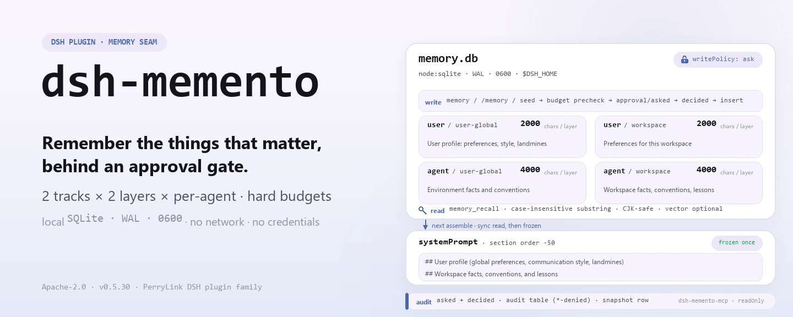
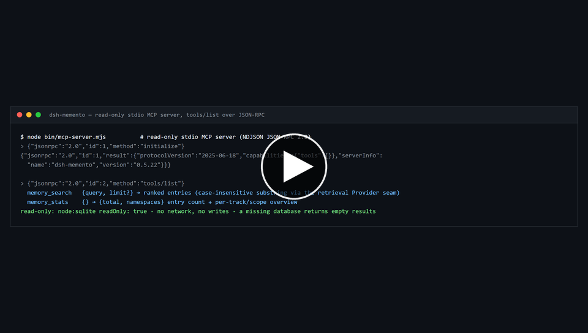

<div align="center">

<picture>
  <source media="(prefers-color-scheme: dark)" srcset="docs/assets/dsh-memento-hero-en-dark.webp">
  
</picture>

# dsh-memento

**Remember across sessions — with every write behind an approval gate and an audit trail.**

A typed `ctx.memory` seam plus a local SQLite provider, a `memory` tool and a frozen snapshot injection: other memory plugins sell a warehouse, this one sells the seam, the write approval gate and an audit chain rebuildable from the session log.

[Install](#three-step-setup) · [Configuration](#configuration) · [FAQ](#faq) · [简体中文](README.md) · [English](README.en.md) · [Español](README.es.md) · [Português](README.pt.md) · [हिन्दी](README.hi.md)

[](LICENSE)
[](#compatibility)
[](https://www.npmjs.com/package/dsh-memento)
[](https://github.com/PerryLink/dsh-memento/actions/workflows/ci.yml)
[](#compatibility)

[](https://github.com/PerryLink/dsh-memento/stargazers)
[](https://www.npmjs.com/package/dsh-memento)
[](https://dshfind.com/plugins/PerryLink/dsh-memento?ref=badge)
[](https://securityscorecards.dev/viewer/?uri=github.com/PerryLink/dsh-memento)
[](https://dsh.market/)
[](https://gitee.com/perrylink/dsh-memento)

```sh
dsh plugin --profile <name> add dsh-memento
```

</div>

<sub>Community plugin, not affiliated with DeepSeek. Canonical repository: <https://github.com/PerryLink/dsh-memento> (Gitee is a mirror).</sub>

## What it is

Write down something worth remembering and it is waiting for the model at the start of the next session — and that write went through an approval gate and left an audit row. `dsh-memento` adds a **capability seam** to DeepSeek Harness rather than another memory warehouse: a typed `ctx.memory` service, a local SQLite provider (`node:sqlite`, WAL, `0600`, default `$DSH_HOME/dsh-memento/memory.db`), and its two consumers — the `memory` tool and a frozen snapshot injected into the system prompt. Two tracks (`user` / `agent`) × two layers (`user-global` / `workspace`) × a per-`agentPreset` key, with hard per-track/per-layer character budgets; `dsh-memento-mcp` adds a read-only stdio MCP entry point.

**See also.** `dsh-mnemon` is a framework with mem0/Honcho hosted providers, pinned to the 0.2.1 line; `@openviking/dsh-memory-plugin` is a Volcengine example with no declared dsh engine; `dsh-plugin-memory` is the closest in kind and has no provenance. `dsh-memento` is the local SQLite seam with an approval gate and audit trail, not a drop-in for the hosted providers.

<picture>
  <source media="(prefers-color-scheme: dark)" srcset="docs/assets/dsh-memento-flow-v5-dark.svg">
  
</picture>

## Three-step setup

1. **Install** (pick one channel):

   ```sh
   # git channel (latest main; equivalent to git+https://github.com/PerryLink/dsh-memento.git)
   dsh plugin --profile web add github:PerryLink/dsh-memento
   # npm channel (published releases)
   dsh plugin --profile web add dsh-memento
   # tarball channel: after npm pack in this repo
   dsh plugin --profile web add ./dsh-memento-<version>.tgz
   ```

   No build step — `index.mjs`, `lib/` and `client/` are the shipped artifacts.

2. **Minimal config** (the defaults already work; this only makes the write policy and the budgets explicit):

   ```yaml
   - insert:
       - id: memento
         name: dsh-memento
         config:
           writePolicy: ask
           budgets:
             user:
               userGlobal: 2000
               workspace: 2000
             agent:
               userGlobal: 4000
               workspace: 4000
   ```

3. **Verify it mounts**:

   ```sh
   dsh --profile web --dump-config | grep -A3 'id: memento'
   ```

   ```
   > /memory budgets
   > /memory list
   ```

**Uninstall**: `dsh plugin --profile web remove dsh-memento` (the memory database and the session logs are kept).

<details>
<summary>Install from the DSH Desktop market</summary>

Every PerryLink plugin is listed in the built-in DSH Desktop market: **Market → Sources → Add source → paste** `https://perrylink-dsh-catalog.perrylink.workers.dev/catalog-source.json` **→ select**. Installation still requires the market's npm identity check and your confirmation.

</details>

*Workflow overview: install → open panel → act. The examples below use the real command surface.*


[](https://github.com/PerryLink/dsh-memento/blob/main/docs/assets/dsh-memento-demo.mp4)

*▶ **2 min 23 s narrated walkthrough** — the thumbnail opens the MP4 file; if it does not play on the page, use *Download raw file* there ([MP4, 1.87 MB](https://github.com/PerryLink/dsh-memento/blob/main/docs/assets/dsh-memento-demo.mp4) · [direct download](https://raw.githubusercontent.com/PerryLink/dsh-memento/main/docs/assets/dsh-memento-demo.mp4)). GitHub strips `<video>` tags from README files, so the video is a file to open rather than something embedded inline.*

## Core capabilities

`dsh-memento` enforces the approval gate **inside the service**, leaves the evidence **in the session log**, and treats a full store as an error rather than an invitation to scribble:

- **The approval gate cannot be bypassed.** Every write path (`add` / `replace` / `remove` / `seed`) is forced through the approval waterfall inside the service, not in the tool layer. `writePolicy: ask | auto | off` is model-invisible configuration; `replace` / `remove` / `consolidate` carry the full text of the entries they change in the approval payload, and a denied write still lands a `*-denied` audit row.
- **Model-visible ⟺ logged.** The injected snapshot lands verbatim in `system/message`; every write is reconstructable from `approval/asked` + `approval/decided` + the plugin's own audit table.
- **Bounded and honest.** Hard per-track/per-layer character budgets (default user 2000 / agent 4000). A full store fails with a structured error (usage + limit) — never truncated, never auto-compacted.
- **The audit gap is visible.** `/memory audit` lists the plugin audit table and appends one line when the session-log side is not written: this harness does not know the `memory/*` session event types, and appending unknown types would make the session unloadable, so writes are audited through `approval/asked` + `approval/decided` and the plugin's table instead. The gate is adaptive — the line disappears on its own once the host knows those types.

Two tracks × two layers × per-agent key: a `user` track (facts about the user) and an `agent` track (environment facts and conventions), each split into `user-global` and `workspace` layers, isolated per `agentPreset`. The snapshot is frozen once per session at first prompt assembly and never changes mid-session.

### Tools & surfaces

| Surface | Kind | Notes |
|---|---|---|
| `memory` | tool | add/replace/remove/consolidate/query with Save/Skip guidance; writes ride the approval gate |
| `memory_recall` | tool | Bounded memory matches plus recent session-history matches |
| `/memory` | command | `list` · `query` · `add` · `remove` · `consolidate` · `proposals` · `budgets` · `audit` · `export` · `import <path>` · `adapters` |
| web panel | client drawer | Read-only: browse entries, search, budget bars, audit tail; the floating entry button can be hidden (`panel.enabled`) |
| settings section | DSH settings sidebar → `dsh-memento` | Edit every config field except `enabled` without touching files (namespace = the `memento` profile entry on the `0.1.7` line, the `dsh-memento` settings namespace before it); live vs reload-required timing is marked on the page |

### Examples

#### Detailed example

**Command**

~~~sh
memory_stats
~~~

**Input**

~~~json
{"jsonrpc":"2.0","id":7,"method":"tools/call","params":{"name":"memory_stats","arguments":{}}}
~~~

**Output**

~~~text
{
  "total": 3,
  "namespaces": [
    {
      "track": "agent",
      "scope": "user-global",
      "count": 1
    },
    {
      "track": "agent",
      "scope": "workspace",
      "count": 1
    },
    {
      "track": "user",
      "scope": "workspace",
      "count": 1
    }
  ]
}
~~~

*Observed from `test/mcp.test.mjs:108-118 (fixture seed at 21-27); README.md:160-176`*

#### Failure branch

**Input**

~~~text
{"jsonrpc":"2.0","id":10,"method":"tools/call","params":{"name":"memory_search","arguments":{}}}
~~~

**Output**

~~~text
{"jsonrpc":"2.0","id":10,"result":{"content":[{"type":"text","text":"invalid arguments: query must be a non-empty string"}],"isError":true}}
~~~

*Observed from `plugins/dsh-memento/lib/mcp.mjs:188; plugins/dsh-memento/test/mcp.test.mjs:126-127; reproduced via plugins/dsh-memento/bin/mcp-server.mjs`*

#### Brief examples

- `/memory`

### MCP server

`dsh-memento` ships a read-only stdio **MCP server** (`dsh-memento-mcp`) so external MCP clients (Claude, Codex, …) can search the memory store without a harness. It speaks JSON-RPC 2.0 over newline-delimited JSON (NDJSON) — one JSON object per line, no `Content-Length` framing.

**Read-only.** The database is opened with `node:sqlite` `readOnly: true` (no migrations, no WAL writes, no recall-count bump); a missing database returns empty results instead of crashing.

| Tool | Purpose |
|---|---|
| `memory_search` | `{query, limit?}` → ranked entries (case-insensitive substring via the retrieval Provider seam) |
| `memory_stats` | `{}` → `{total, namespaces}` entry count + per-track/scope overview |

Run it directly:

```sh
node bin/mcp-server.mjs
# or, after npm install: npx dsh-memento-mcp
```

The database path is `$DSH_MEMENTO_DB_PATH` (absolute, or relative to `$DSH_HOME`); it defaults to `$DSH_HOME/dsh-memento/memory.db`.

Claude Desktop (`claude_desktop_config.json`) example:

```json
{
  "mcpServers": {
    "dsh-memento": {
      "command": "npx",
      "args": ["-y", "dsh-memento-mcp"],
      "env": {
        "DSH_MEMENTO_DB_PATH": "/home/you/.dsh/dsh-memento/memory.db"
      }
    }
  }
}
```

The server is read-only: no network, no writes, no approval gate — search and stats only.

### dsh-memory-protocol v1

`dsh-memento` is the community rehearsal of the DSH memory protocol — a candidate shape for an official `ctx.memory` seam. The protocol normalizes this plugin's seam into a cross-plugin contract:

- **Entry spec** — two tracks × two layers × per-agent key, plus short `tags` (≤16 × ≤32 chars) and a per-entry `version` that increments on every `replace`.
- **Write semantics** — idempotent unique-substring conditional writes; approve-what-you-see payloads (`replace` / `remove` / `consolidate` carry the full text they change).
- **Audit contract** — every write reconstructable from `approval/asked` + `approval/decided` + the provider ledger.
- **Budget model** — `BUDGET_EXCEEDED` / `AMBIGUOUS_MATCH` semantics.
- **Schema versioning** — migration rules with loud version checks.

- **Spec** — [docs/protocol-v1.md](docs/protocol-v1.md) (Chinese: [protocol-v1.zh.md](docs/protocol-v1.zh.md)); normative JSON Schema at [docs/schemas/dsh-memory-protocol-v1.schema.json](docs/schemas/dsh-memory-protocol-v1.schema.json).

**Adapter registry** — `ctx.memoryAdapters` (`register` / `list` / `adapt` / `export`) lets third-party memory plugins speak the protocol by registering a pure data converter (reversible `register()`; import rides the approval-gated `seed`, export is read-only). Onboarding: [docs/adapters-guide.md](docs/adapters-guide.md) (Chinese: [adapters-guide.zh.md](docs/adapters-guide.zh.md)).

| Built-in adapter | External format | Notes |
|---|---|---|
| `mem0` | mem0 fact collections (`{facts: [{memory, metadata?}]}`) | `metadata.category` / `metadata.tags` become tags; raw `messages` arrays are rejected — adapters convert, never extract |
| `hermes-memory-md` | Hermes `memory.md` (`## section` + bullets) | section names become tags; non-bullet prose fails loudly |
| `claude-code-memory-md` | `CLAUDE.md`-style markdown (headings, bullets, paragraphs) | bullets and paragraphs become entries; section names become tags |

**Conformance suite** — [test/protocol-conformance/](test/protocol-conformance/README.md): a distributable case set any provider claiming compatibility runs (`node test/protocol-conformance/run.mjs --provider ./your-factory.mjs`); this repo's CI runs it against its own provider as the golden reference (`npm run test:conformance`).

- **Upstream proposal** — [docs/upstream-proposal.md](docs/upstream-proposal.md) (Chinese: [upstream-proposal.zh.md](docs/upstream-proposal.zh.md)): why the official `ctx.memory` seam should adopt the protocol, the differences, and the migration path.

### How it differs from other memory plugins

| Plugin | What it is | dsh-memento's difference |
|---|---|---|
| dsh-memory-evolve | memory warehouse / evolution loops | a typed service seam, approval gate, and session-log audit; no warehouse ambition |
| dsh-mnemon | memory store helper | protocol + gate + audit, not another store |
| dsh-kb-sieve | knowledge-base sieving | no retrieval engineering: small-corpus substring search, cross-session recall via `session_search`/`sessionQuery` |
| dsh-tdai-memory | task-driven memory tooling | budgets are per track×layer and enforced in the service, not best-effort |
| claude-bridge | Claude Code bridging | DSH-native; a future `seed(source:'claude')` path lets a bridge feed the same store |
| dsh-external/Recall | external agent memory | local-first, zero-network, rides DSH's own approval seam |
| Official MCP memory examples | DSH's stated "memory = external MCP" position | the **native first-party** complement: same goal, no external server; both coexist |

The name is **`dsh-memento`** (published on npm and GitHub). Not `dsh-recall` (confusable with dsh-external/Recall), not the deleted legacy name `dsh-memory`.

### What we learned from the terminal memories

`dsh-memento` is not a port of Claude Code, Codex, or Hermes — but its design deliberately absorbed the parts each got right, and refused the parts that hurt:

| Terminal memory | What it got right | What dsh-memento adopted |
|---|---|---|
| **Claude Code** — `CLAUDE.md` | hierarchical plain-text memory files (user-level → project-level), human-readable and human-editable, merged automatically into every session | plain-text entries; `user-global` / `workspace` layers merged per session; a store you can browse, `export`, and audit — transparency as a feature |
| **Codex** — `AGENTS.md` | per-directory scoped instructions auto-discovered and injected with zero model friction | the `workspace` layer keyed by the session cwd (Windows case-insensitive); the frozen snapshot injected automatically at session start |
| **Hermes** — `memory.md` | proactive memory saves and the security lesson that a gate enforced only in the tool layer is bypassable by late tool injection | the `memory` tool with Save/Skip guidance + approval-gated auto-capture proposals; the gate lives inside `ctx.memory`'s write methods, not in the tool layer |

Sources: [Claude Code memory](https://code.claude.com/docs/en/memory) · [Codex AGENTS.md](https://developers.openai.com/codex/cli/agents-md) · [Hermes memory](https://github.com/NousResearch/hermes-agent/blob/main/website/docs/user-guide/features/memory.md) · [Hermes #48181](https://github.com/NousResearch/hermes-agent/issues/48181).

And the parts deliberately refused: hidden auto-summarization into model-private state (compaction summaries here become **pending proposals** that wait for a human approve/dismiss), warehouse/vector-store ambitions, and any write that lacks a human-visible approval or audit trail. Also adopted: Hermes's documented caveat that two processes sharing one home directory write the same memory file — see Security boundaries.

## Configuration

All tunables are Schemastery `Config` fields (changeable from cordis.yml); invalid values fail loudly at load. An id-targeted override replaces the whole row — restate every key you need. `cordis.patch.yml` is the bundle declaration, and that row's `id` (`memento`) is also the settings form namespace.

**Settings panel.** On the `0.1.7` line the plugin's own `Config` **is** its settings page: the form's namespace is the profile entry id (`memento` — the `id:` of this bundle's row), the editable fields are exactly the ones the plugin declares `.volatile()` (every key below except `enabled`), and an accepted edit is merged into the profile's plugin row and committed into the running plugin — no file editing, no restart. Nearly everything applies live (write policies, language, budgets, limits, proposals, panel, `dbPath` / `auditRetentionDays` via a store reopen, `retrieval.vector` via a retriever swap); what a plugin registers at load time (`snapshotOrder`, tool descriptions) is re-read on reload, and the page marks those fields. Numeric bounds are declared in the schema as well, so an out-of-range edit is refused at write time instead of leaving an unusable config behind. On the older lines (`0.1.2-rc.1`, `0.1.5-alpha.1`, `0.1.6-0`) the same card edits the `dsh-memento` settings namespace exactly as before; with no settings service at all, everything falls back to the composed cordis config. The floating panel button can be hidden from the same page (`panel.enabled`).

Most-used keys:

| Key | Default | Meaning |
|---|---|---|
| `enabled` | `true` | Master switch; `false` removes the service, tools, snapshot, command, panel, and answerer (not editable from the settings page — a disabled plugin has no settings entry) |
| `panel.enabled` | `true` | Show the web panel's floating button; saving `false` from the settings page hides the 🧠 entry immediately, no reload needed (the settings page itself stays reachable) |
| `dbPath` | `''` → `$DSH_HOME/dsh-memento/memory.db` | Absolute, or relative to `$DSH_HOME` (falls back to `~/.dsh` on Windows) |
| `budgets.user.userGlobal` | `2000` | Hard character budget for the user track's user-global layer |
| `writePolicy` | `'ask'` | Default write policy: `ask` / `auto` / `off` (model-invisible) |
| `language` | `'en'` | Model-visible and command output language: `en` / `zh` |
| `retrieval.vector` | `false` | Semantic recall switch: `true` enables `memory_recall` vector recall (fake hash embedding) when an embedding provider is available; otherwise degrades to substring |

<details>
<summary>Full configuration table (25 keys)</summary>

| Key | Default | Meaning |
|---|---|---|
| `enabled` | `true` | Master switch; `false` removes the service, tools, snapshot, command, panel, and answerer (not editable from the settings page — a disabled plugin has no settings entry) |
| `panel.enabled` | `true` | Show the web panel's floating button; saving `false` from the settings page hides the 🧠 entry immediately, no reload needed (the settings page itself stays reachable) |
| `dbPath` | `''` → `$DSH_HOME/dsh-memento/memory.db` | Absolute, or relative to `$DSH_HOME` (falls back to `~/.dsh` on Windows) |
| `budgets.user.userGlobal` | `2000` | Hard character budget for the user track's user-global layer |
| `budgets.user.workspace` | `2000` | Hard character budget for the user track's workspace layer |
| `budgets.agent.userGlobal` | `4000` | Hard character budget for the agent track's user-global layer |
| `budgets.agent.workspace` | `4000` | Hard character budget for the agent track's workspace layer |
| `writePolicy` | `'ask'` | Default write policy: `ask` / `auto` / `off` (model-invisible) |
| `writePolicies` | `{}` | Per-track/scope or per-source overrides (e.g. `user/workspace`, `source:claude`) |
| `language` | `'en'` | Model-visible and command output language: `en` / `zh` |
| `snapshotOrder` | `-50` | Snapshot section order (after harness identity, before persona) |
| `maxEntriesPerQuery` | `20` | Default per-query result cap (hard-capped at 1000) |
| `commandListLimit` | `50` | Entries rendered per `/memory list` / `query` |
| `commandAuditLimit` | `10` | Audit rows rendered per `/memory audit` |
| `recall.historyLimitDefault` | `8` | `memory_recall` sessions scanned by default |
| `recall.snippetCap` | `5` | `memory_recall` snippets per session |
| `recall.snippetChars` | `300` | `memory_recall` snippet characters |
| `recall.windowDays` | `30` | `memory_recall` recency window in days |
| `retrieval.vector` | `false` | Semantic recall switch: `true` enables `memory_recall` vector recall (fake hash embedding) when an embedding provider is available; otherwise degrades to substring |
| `panelEntriesLimit` | `200` | Web panel entries page size |
| `panelAuditLimit` | `20` | Web panel audit rows by default |
| `auditRetentionDays` | `0` | Audit retention (0 = keep forever) |
| `proposals.enabled` | `true` | Auto-capture a memory proposal after each successful compaction |
| `proposals.maxChars` | `2000` | Proposal character cap |
| `proposals.maxPending` | `8` | Pending proposal cap |

</details>

Example override in your profile patch:

```yaml
- insert:
    - id: memento
      name: dsh-memento
      config:
        writePolicy: auto
        retrieval:
          vector: true
        language: en
```

## FAQ

<details>
<summary>Where do the memories actually live? Do they ride along with the session log?</summary>

By default in a local `$DSH_HOME/dsh-memento/memory.db` (`node:sqlite`, WAL, POSIX `0600`) — zero network, zero credentials. The session log carries neither the database nor its contents: the **snapshot text injected into the model** lands verbatim in `system/message` alongside an `audit(snapshot)` row, which is the "model-visible ⟺ logged" guarantee rather than a leak; the store itself never leaves your machine. Uninstalling keeps both the database and the session logs.

</details>

<details>
<summary>What happens when the host does not know the `memory/*` session event types? Is the audit chain broken?</summary>

No — it just runs on a different chain. As of `0.2.1-alpha.2`, `KNOWN_SESSION_EVENT_TYPES` still has no `memory/*`, and appending an unregistered type would make that session unloadable, so the runtime gate stays closed: the audit comes from the `approval/asked` + `approval/decided` pair plus the plugin's own `audit` table, `/memory audit` appends one line when the session-log side is missing, and the process warns once. The gate is adaptive — it turns on by itself once the host records those types, with no code change. The `ask` policy fails closed the same way: with no answerer the write is denied instead of silently allowed.

</details>

<details>
<summary>Does it fight other plugins over tool names, service keys or slots?</summary>

No. Every tool is namespaced; it provides four service keys (`memory`, `memoryAdapters`, `memoryEmbedding`, `memoryRetrieval`), none of them a built-in seam; it registers no client slot, no `webServer` prefix, never overrides a built-in row's `config`, and mutates no globals. The point-by-point argument is in "Interoperability with other DSH plugins".

</details>

<details>
<summary>Does a full store get truncated quietly? How big is the overhead?</summary>

Neither. The budget is checked twice in the service (before and after approval); a full store throws a structured `BUDGET_EXCEEDED` (with used / limit / needed) so the model can consolidate or remove and retry — never truncated, never auto-compacted. Ambiguous substring matches throw `AMBIGUOUS_MATCH`. On the cost side: the provider is a single-connection synchronous SQLite, no network and no model calls, and the snapshot is rendered once per session and frozen, so the system-prompt prefix stays stable within a session (prefix-cache friendly).

</details>

## Security boundaries

- **Public services only.** Consumes `tools`, `systemPrompt`, and the approval seam; no engine / agent-loop / apiproxy / official-UI changes.
- **Zero network, zero credentials.** Local database with POSIX file mode `0600`.
- **Fail loud.** Corrupt DB, newer schema, or invalid config fails at load; full budgets and ambiguous substring matches fail with structured errors.
- **One process, one store.** Multiple sessions share the SQLite store; two processes sharing one `$DSH_HOME` write the same file (last-writer-wins under SQLite locking).

## Permissions & data

- **Permissions**: declares `harness:tool`, `filesystem:read`, `filesystem:write`, and `network:none` / `subprocess:none` / `shell:none` / `python:none` / `credentials:none` in its workshop manifest. Write approval rides the official approval seam.
- **Data**: local SQLite database (`0600`), zero network, zero credentials.
- **Session log**: audit completeness comes from the approval pair (`approval/asked` + `approval/decided`) plus the plugin's own audit table; the session-log side of that gap is declared in `/memory audit` and disappears once the host registers `memory/*`.

## Known limitations

- **Session events are declared, not yet emitted (rc.2).** `memory/added|updated|removed|recalled|snapshot` are merge-declared, but rc.2 has no registration surface for out-of-repo event types; emission turns on once a harness build registers them.
- **`ask` policy needs an answerer.** With no UI/ACP answerer composed, writes fail closed.
- **No FTS5 indexing.** Substring search runs on case-insensitive `instr` (correct for CJK).

## Interoperability with other DSH plugins

Verified against **DSH `0.2.0-rc.2`** (the runtime this README ships for) and the high-star plugin set surveyed on 2026-10-05.

This plugin **does not interfere** with other plugins, including the widely installed high-star ones:

- **No tool-name collision.** Every tool is namespaced; no bare name owned by a shipped tool or another plugin is registered.
- **No service-key collision.** It provides `memory`, `memoryAdapters`, `memoryEmbedding`, `memoryRetrieval`; those keys are not a built-in seam and are not provided by any surveyed high-star plugin.
- **No slot collision.** It registers no client slot key, so it cannot contend for a `shadows-shipped-ui` seat.
- **No HTTP route collision.** It registers no `webServer` prefix.
- **No patch-layer collision.** The bundle patch only `insert`s its own row; it never overrides a built-in row's `config`.
- **No global mutation.** It does not patch prototypes, rewrite `process.env`, or replace the global fetch dispatcher.

**Shared event listeners are non-interfering by construction.** It observes the ordering-sensitive event `approval/request` with `ctx.on()` — Cordis's broadcast registration, where every listener runs and none can starve another. **Every listener here delegates through `next()`**, so the chain is never short-circuited, and a mutation is applied to the value `next()` produced rather than returned in its place:

Static evidence: `dsh-plugin-doctor` K10–K13 report `pass` for every check on this repository.

## Compatibility

| Surface | Status |
|---|---|
| Harness | DeepSeek Harness `dsh-v0.2.1-alpha.2` (adapted 2026-10-12; `0.2.1-alpha.1` since 2026-10-04): the `0.1.7` line replaced the whole settings registration surface (`installSettingsSection` / `SettingsProvider.installSection` / `SettingsNamespace` / `SettingsScope`) with live Config forms, so both halves follow the new contract — a form's namespace is the profile entry id (`memento`), its editable fields are the `.volatile()` ones, and an accepted edit is committed into the running plugin instead of remounting it. The browser half reads that form through `ctx.configForms.get(entryId)` (the `ctx.settingsScope` service is gone). Both halves keep their `installSection` / `settingsScope` branches for the `0.1.2-rc.1`, `0.1.5-alpha.1` and `0.1.6-0` lines the peer range still advertises, and the new `>=0.1.7-0 <0.2.0` clause is what makes the target host itself installable (the old range excluded it by semver's prerelease rule). Still no plugin event-registration surface — `KNOWN_SESSION_EVENT_TYPES` does not carry `memory/*`, and `Session.append`'s third argument only carries a `SurfaceIntent` for surface-eligible types, so the audit gate stays adaptive and skips as before (it says so once per process and in `/memory audit`). Type evidence comes from three faces: the local checkout's built types, the pinned published line in `node_modules`, and the browser half under a DOM lib. **Re-verified against `0.2.1-alpha.2`:** every plugin-facing seam this package touches is byte-identical between the two tags (`packages/settings/settings/src/**`, `packages/client/ui-settings/src/**`, `packages/client/ui-slots/src/**`, `packages/client/modules/src/**`, `packages/interaction/user-approval/**`, `vendor/loader/src/**`, `vendor/schemastery/src/**`, `packages/boot/app-boot/src/config-schema/**`), the session format is still v4 with no v4→v5 migration, and `KNOWN_SESSION_EVENT_TYPES` gained only one first-party type — so the adaptive audit gate stays closed and **no code change was needed**. What moved is the pinned dev/test line (`0.2.1-alpha.2`, plus its `pnpm-workspace.yaml` release-age allowlist entries) and the compatibility baseline; `npm test` (201 cases, including the real-Loader composition suite), `typecheck:ci`, coverage, artifact, conformance and five-language gates all pass against it. alpha.2 does add a `plugin:<name>/*`-namespaced `appendPluginRecord` writer, but the host's own `packages/core/session/README.md` forbids out-of-repo callers and the mandatory `plugin:` prefix cannot express `memory/*`, so this package does not adopt it. |
| Node | `^22.19.0 \|\| >=24.9.0` |
| Platforms | Windows / macOS / Linux (pure host; no native code, no network) |
| Model | Any |

## Ecosystem & quality

- [Gitee mirror](https://gitee.com/perrylink/dsh-memento) (sync mirror; GitHub is canonical)
- [dshfind plugin page](https://dshfind.com/plugins/PerryLink/dsh-memento) (installs and ranking)
- [OpenSSF Scorecard report](https://securityscorecards.dev/viewer/?uri=github.com/PerryLink/dsh-memento) (driven by [.github/workflows/scorecard.yml](.github/workflows/scorecard.yml))
- [dsh-plugin-doctor verification report](https://github.com/PerryLink/dsh-plugin-doctor#verified-徽章) (K10–K13 all `pass`)
- [DSH Market](https://dsh.market/) (listed)
- **1024 store channel**: `npm i -g dsh1024` once, then `dsh1024 plugin --profile web add dsh-memento` (counts toward the [deepseek1024.com](https://deepseek1024.com) install ranking)
- [Ecosystem knowledge base](https://perrylink.github.io/dsh-plugin-guide/) — measured data, not marketing: plugin development guide · plugin-selection data · maintenance criteria

## Development

```sh
npm install              # node ^22.19 || >=24.9
npm test                 # node --test
npm run lint             # oxlint
npm run test:conformance # dsh-memory-protocol v1 conformance suite
npm run typecheck        # host face vs a local D:\deepseek-harness checkout (prints "not verifiable" and exits 0 without one)
npm run typecheck:ci     # host face vs the pinned published line in node_modules
npm run check:client     # browser half (DOM lib) type gate
npm run check:coverage   # line-coverage gate
npm run check:readmes    # five-language README consistency gate
npm run verify:self-contained # reject out-of-repo dependency specs
npm run verify:artifacts # artifact presence + syntax + import
```

`lib/` is zero-DSH-dependency (node: builtins only); DSH imports exist only in `index.mjs`.

The README images are generated programmatically by [`scripts/gen-readme-assets.py`](scripts/gen-readme-assets.py) (Python + Pillow) and are safe to re-run.

Topics: `dsh`, `dsh-plugin`, `deepseek-harness`, `memory`, `agent-memory`, `approval`, `audit`, `sqlite`, `cordis`, `llm`

## Family & thanks

This project is part of the DeepSeek Harness plugin family from [PerryLink](https://github.com/PerryLink) (all Apache-2.0). If it is useful, **a star helps the next person find it** — nothing is gated behind it.

- [@alone-tree](https://github.com/alone-tree) — the DSH settings panel entry and the hideable floating entry button (#8).
- [@zzproc](https://github.com/zzproc) — the `memory_recall` output schema `source`/`tags` fix (#11).
- [@alone-tree](https://github.com/alone-tree) — DSH settings panel entry and hideable floating window (#8).
- [@zzproc](https://github.com/zzproc) — `memory_recall` output schema `source`/`tags` fix (#11).

- [@Niuniu-Sir](https://github.com/Niuniu-Sir) — the boot-crash report in [issue #1](https://github.com/PerryLink/dsh-memento/issues/1) that led to the `~/.dsh` fallback shipped in 0.3.1.
- [@alex-debap](https://github.com/alex-debap) — **product manager**. Owned the shape of the product rather than its code, across the whole design arc from the outset: the seam-not-warehouse thesis (a typed `ctx.memory` seam, not another memory warehouse), the requirement that the write-approval gate be enforced inside the service so that no model path can bypass it rather than being a tool-layer convention, and the audit guarantee that every write be rebuildable from the approval pair plus the plugin's own audit table. Named the bounded, layered recall model — two tracks × two layers, per-agent key, hard per-track/per-layer character budgets — and argued for local-first, zero-credential storage (`0600` SQLite under `$DSH_HOME`, no network, no keys). Carried the protocol work as a product line: the public `dsh-memory-protocol` v1 rehearsal, its adapter registry and its conformance suite. Held the scope line on what this plugin deliberately does not do.

<details>
<summary>Expand all plugins</summary>

| Plugin | Status |
|---|---|
| **[dsh-aqua-input-check](https://github.com/PerryLink/dsh-aqua-input-check)** |  |
| **[dsh-archive-check](https://github.com/PerryLink/dsh-archive-check)** |  |
| **[dsh-auto-review](https://github.com/PerryLink/dsh-auto-review)** |  |
| **[dsh-autotier](https://github.com/PerryLink/dsh-autotier)** | 🧊 FROZEN — see the repo README |
| **[dsh-bid-ca-precheck](https://github.com/PerryLink/dsh-bid-ca-precheck)** |  |
| **[dsh-bid-qual-check](https://github.com/PerryLink/dsh-bid-qual-check)** |  |
| **[dsh-cert-mcp](https://github.com/PerryLink/dsh-cert-mcp)** | 🧊 FROZEN — see the repo README |
| **[dsh-checkpoint-rewind](https://github.com/PerryLink/dsh-checkpoint-rewind)** |  |
| **[dsh-click](https://github.com/PerryLink/dsh-click)** |  |
| **[dsh-composer-history](https://github.com/PerryLink/dsh-composer-history)** |  |
| **[dsh-contract-stance](https://github.com/PerryLink/dsh-contract-stance)** |  |
| **[dsh-customs-doc-check](https://github.com/PerryLink/dsh-customs-doc-check)** |  |
| **[dsh-data-quality](https://github.com/PerryLink/dsh-data-quality)** | 🧊 FROZEN — see the repo README |
| **[dsh-demurrage-ledger](https://github.com/PerryLink/dsh-demurrage-ledger)** |  |
| **[dsh-doublecheck](https://github.com/PerryLink/dsh-doublecheck)** |  |
| **[dsh-drill-script-check](https://github.com/PerryLink/dsh-drill-script-check)** |  |
| **[dsh-eia-guide-check](https://github.com/PerryLink/dsh-eia-guide-check)** |  |
| **[dsh-emergency-plan](https://github.com/PerryLink/dsh-emergency-plan)** |  |
| **[dsh-essay-rubric-check](https://github.com/PerryLink/dsh-essay-rubric-check)** |  |
| **[dsh-evidence-check](https://github.com/PerryLink/dsh-evidence-check)** |  |
| **[dsh-export-ctl-check](https://github.com/PerryLink/dsh-export-ctl-check)** |  |
| **[dsh-fast](https://github.com/PerryLink/dsh-fast)** |  |
| **[dsh-fmea-table-check](https://github.com/PerryLink/dsh-fmea-table-check)** |  |
| **[dsh-forecast-penalty](https://github.com/PerryLink/dsh-forecast-penalty)** |  |
| **[dsh-fund-research](https://github.com/PerryLink/dsh-fund-research)** |  |
| **[dsh-github](https://github.com/PerryLink/dsh-github)** |  |
| **[dsh-gongwen-flow-check](https://github.com/PerryLink/dsh-gongwen-flow-check)** |  |
| **[dsh-gongwen-word-check](https://github.com/PerryLink/dsh-gongwen-word-check)** |  |
| **[dsh-guard-plan-qc](https://github.com/PerryLink/dsh-guard-plan-qc)** |  |
| **[dsh-hazchem-check](https://github.com/PerryLink/dsh-hazchem-check)** |  |
| **[dsh-hazplan-check](https://github.com/PerryLink/dsh-hazplan-check)** |  |
| **[dsh-hidden-risk-map](https://github.com/PerryLink/dsh-hidden-risk-map)** |  |
| **[dsh-hs-classify](https://github.com/PerryLink/dsh-hs-classify)** |  |
| **[dsh-icd-rule-check](https://github.com/PerryLink/dsh-icd-rule-check)** |  |
| **[dsh-industry-research](https://github.com/PerryLink/dsh-industry-research)** |  |
| **[dsh-lawcite-adapter](https://github.com/PerryLink/dsh-lawcite-adapter)** |  |
| **[dsh-laya](https://github.com/PerryLink/dsh-laya)** |  |
| **[dsh-lc-doc-check](https://github.com/PerryLink/dsh-lc-doc-check)** |  |
| **[dsh-learning-gap-check](https://github.com/PerryLink/dsh-learning-gap-check)** |  |
| **[dsh-library](https://github.com/PerryLink/dsh-library)** |  |
| **[dsh-local-ai](https://github.com/PerryLink/dsh-local-ai)** |  |
| **[dsh-lsp-actions](https://github.com/PerryLink/dsh-lsp-actions)** |  |
| **[dsh-mask](https://github.com/PerryLink/dsh-mask)** |  |
| **[dsh-mcp-panel](https://github.com/PerryLink/dsh-mcp-panel)** |  |
| **[dsh-medrec-qc](https://github.com/PerryLink/dsh-medrec-qc)** |  |
| **[dsh-memento](https://github.com/PerryLink/dsh-memento)** | 🧊 FROZEN — see the repo README |
| **[dsh-nsfc-form-check](https://github.com/PerryLink/dsh-nsfc-form-check)** |  |
| **[dsh-nurse-record-check](https://github.com/PerryLink/dsh-nurse-record-check)** |  |
| **[dsh-observe](https://github.com/PerryLink/dsh-observe)** |  |
| **[dsh-origin-rvc-check](https://github.com/PerryLink/dsh-origin-rvc-check)** |  |
| **[dsh-ota-review-check](https://github.com/PerryLink/dsh-ota-review-check)** |  |
| **[dsh-output-styles](https://github.com/PerryLink/dsh-output-styles)** |  |
| **[dsh-paper-doc-adapter](https://github.com/PerryLink/dsh-paper-doc-adapter)** |  |
| **[dsh-permission-rules](https://github.com/PerryLink/dsh-permission-rules)** |  |
| **[dsh-permit-report-check](https://github.com/PerryLink/dsh-permit-report-check)** |  |
| **[dsh-pipeline-check](https://github.com/PerryLink/dsh-pipeline-check)** |  |
| **[dsh-pleading-draft](https://github.com/PerryLink/dsh-pleading-draft)** |  |
| **[dsh-plugin-doctor](https://github.com/PerryLink/dsh-plugin-doctor)** | 🚫 RETIRED (repo archived) |
| **[dsh-plugin-guide](https://github.com/PerryLink/dsh-plugin-guide)** |  |
| **[dsh-plugin-kit](https://github.com/PerryLink/dsh-plugin-kit)** | 🚫 RETIRED (repo archived) |
| **[dsh-plugin-upgrade](https://github.com/PerryLink/dsh-plugin-upgrade)** | 🚫 RETIRED (repo archived) |
| **[dsh-policy-brief-draft](https://github.com/PerryLink/dsh-policy-brief-draft)** |  |
| **[dsh-power-loss-split](https://github.com/PerryLink/dsh-power-loss-split)** |  |
| **[dsh-power-ticket-check](https://github.com/PerryLink/dsh-power-ticket-check)** |  |
| **[dsh-ppap-check](https://github.com/PerryLink/dsh-ppap-check)** |  |
| **[dsh-protest-deadline](https://github.com/PerryLink/dsh-protest-deadline)** |  |
| **[dsh-railway-window](https://github.com/PerryLink/dsh-railway-window)** |  |
| **[dsh-repair-order-qc](https://github.com/PerryLink/dsh-repair-order-qc)** |  |
| **[dsh-research-report](https://github.com/PerryLink/dsh-research-report)** |  |
| **[dsh-review-reply-check](https://github.com/PerryLink/dsh-review-reply-check)** |  |
| **[dsh-rulefile-check](https://github.com/PerryLink/dsh-rulefile-check)** |  |
| **[dsh-safety-brief-check](https://github.com/PerryLink/dsh-safety-brief-check)** |  |
| **[dsh-score](https://github.com/PerryLink/dsh-score)** | 🧊 FROZEN — see the repo README |
| **[dsh-session-sync](https://github.com/PerryLink/dsh-session-sync)** |  |
| **[dsh-site-log-check](https://github.com/PerryLink/dsh-site-log-check)** |  |
| **[dsh-skill-pack-security](https://github.com/PerryLink/dsh-skill-pack-security)** |  |
| **[dsh-soe-decision-check](https://github.com/PerryLink/dsh-soe-decision-check)** |  |
| **[dsh-soilwater-check](https://github.com/PerryLink/dsh-soilwater-check)** |  |
| **[dsh-sop-sync-check](https://github.com/PerryLink/dsh-sop-sync-check)** |  |
| **[dsh-spc-gbt-adapter](https://github.com/PerryLink/dsh-spc-gbt-adapter)** |  |
| **[dsh-talk](https://github.com/PerryLink/dsh-talk)** |  |
| **[dsh-tender-extract](https://github.com/PerryLink/dsh-tender-extract)** |  |
| **[dsh-tender-matrix](https://github.com/PerryLink/dsh-tender-matrix)** |  |
| **[dsh-test-drive](https://github.com/PerryLink/dsh-test-drive)** |  |
| **[dsh-ticktick](https://github.com/PerryLink/dsh-ticktick)** | 🚫 RETIRED (repo archived) |
| **[dsh-translate](https://github.com/PerryLink/dsh-translate)** |  |
| **[dsh-warranty-calc](https://github.com/PerryLink/dsh-warranty-calc)** |  |
| **[dsh-budget](https://github.com/PerryLink/dsh-budget)** | 🧊 FROZEN — see the repo README |
| **[dsh-claude-move](https://github.com/PerryLink/dsh-claude-move)** | 🧊 FROZEN — see the repo README |
| **[dsh-defend](https://github.com/PerryLink/dsh-defend)** | 🧊 FROZEN — see the repo README |
| **[dsh-draw](https://github.com/PerryLink/dsh-draw)** | 🧊 FROZEN — see the repo README |
| **[dsh-reach](https://github.com/PerryLink/dsh-reach)** | 🧊 FROZEN — see the repo README |
| **[dsh-background-agents](https://github.com/PerryLink/dsh-background-agents)** | 🚫 RETIRED (repo archived) |
| **[dsh-session-pin](https://github.com/PerryLink/dsh-session-pin)** | 🚫 RETIRED (repo archived) |
| **[dsh-team-rooms](https://github.com/PerryLink/dsh-team-rooms)** | 🚫 RETIRED (repo archived) |

</details>

## License

[Apache License 2.0](LICENSE) © 2026 dsh-memento contributors

<p align="center"><sub>Apache-2.0 · Community plugin, not affiliated with DeepSeek.</sub></p>
