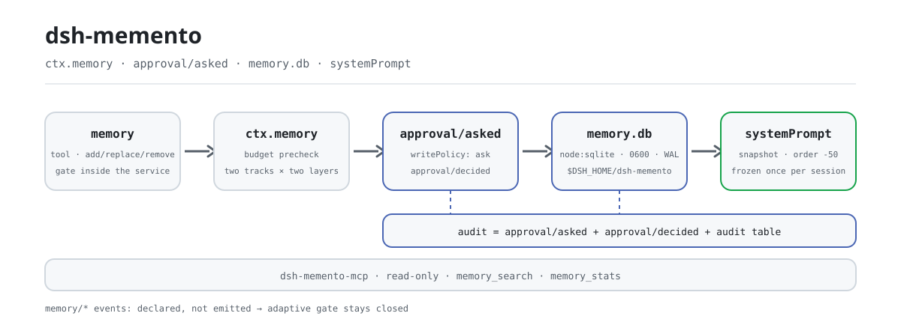
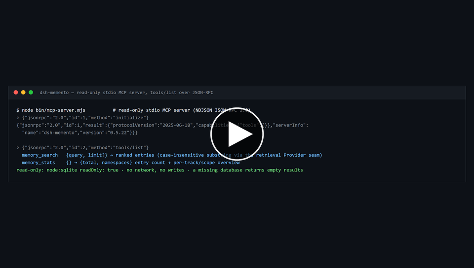

<div align="center">

<picture>
  <source media="(prefers-color-scheme: dark)" srcset="docs/assets/dsh-memento-flow-dark.svg">
  
</picture>

# dsh-memento

**Recuerda entre sesiones, con cada escritura detrás de una puerta de aprobación y de un rastro de auditoría.**

Una costura tipada `ctx.memory` más un proveedor SQLite local, la herramienta `memory` y la inyección de una instantánea congelada: otros plugins de memoria venden un almacén; este vende la costura, la puerta de aprobación de escritura y una auditoría reconstruible desde el registro de sesión.

[Instalar](#instalación-en-tres-pasos) · [Configuración](#configuración) · [FAQ](#faq) · [简体中文](README.md) · [English](README.en.md) · [Español](README.es.md) · [Português](README.pt.md) · [हिन्दी](README.hi.md)

[](LICENSE)
[](#compatibilidad)
[](https://www.npmjs.com/package/dsh-memento)
[](https://github.com/PerryLink/dsh-memento/actions/workflows/ci.yml)
[](#compatibilidad)

[](https://github.com/PerryLink/dsh-memento/stargazers)
[](https://www.npmjs.com/package/dsh-memento)
[](https://dshfind.com/plugins/PerryLink/dsh-memento?ref=badge)
[](https://securityscorecards.dev/viewer/?uri=github.com/PerryLink/dsh-memento)
[](https://dsh.market/)
[](https://gitee.com/perrylink/dsh-memento)

```sh
dsh plugin --profile <name> add dsh-memento
```

</div>

<sub>Plugin de la comunidad, no afiliado a DeepSeek. Repositorio canónico: <https://github.com/PerryLink/dsh-memento> (Gitee es un espejo).</sub>

## Qué es

Escribe algo que merezca recordarse y estará esperando al modelo al inicio de la sesión siguiente — y esa escritura pasó por una puerta de aprobación y dejó una fila de auditoría. `dsh-memento` aporta a DeepSeek Harness una **costura de capacidad**, no otro almacén de memoria: un servicio tipado `ctx.memory`, un proveedor SQLite local (`node:sqlite`, WAL, `0600`, por defecto `$DSH_HOME/dsh-memento/memory.db`) y sus dos consumidores — la herramienta `memory` y una instantánea congelada inyectada en el prompt del sistema. Dos pistas (`user` / `agent`) × dos capas (`user-global` / `workspace`) × clave por `agentPreset`, con presupuestos estrictos de caracteres por pista y por capa; `dsh-memento-mcp` añade una entrada MCP stdio de solo lectura.

**Véase también.** `dsh-mnemon` es un framework con proveedores alojados mem0/Honcho, fijado a la línea 0.2.1; `@openviking/dsh-memory-plugin` es un ejemplo de Volcengine sin `dsh` engine declarado; `dsh-plugin-memory` es el más cercano en especie y no tiene procedencia. `dsh-memento` es la costura SQLite local con puerta de aprobación y auditoría, no un reemplazo directo de los proveedores alojados.

## Instalación en tres pasos

1. **Instalar** (elige un canal):

   ```sh
   # canal git (último main; equivale a git+https://github.com/PerryLink/dsh-memento.git)
   dsh plugin --profile web add github:PerryLink/dsh-memento
   # canal npm (versiones publicadas)
   dsh plugin --profile web add dsh-memento
   # canal tarball: tras npm pack en este repo
   dsh plugin --profile web add ./dsh-memento-<version>.tgz
   ```

   Sin paso de build: `index.mjs`, `lib/` y `client/` son los artefactos publicados.

2. **Configuración mínima** (los valores por defecto ya sirven; esto solo explicita la política de escritura y los presupuestos):

   ```yaml
   - insert:
       - id: memento
         name: dsh-memento
         config:
           writePolicy: ask
           budgets:
             user:
               userGlobal: 2000
               workspace: 2000
             agent:
               userGlobal: 4000
               workspace: 4000
   ```

3. **Comprobar que está activo**:

   ```sh
   dsh --profile web --dump-config | grep -A3 'id: memento'
   ```

   ```
   > /memory budgets
   > /memory list
   ```

**Desinstalar**: `dsh plugin --profile web remove dsh-memento` (la base de datos de memoria y los registros de sesión se conservan).

<details>
<summary>Instalar desde el mercado de DSH Desktop</summary>

Todos los plugins de PerryLink están en el mercado integrado de DSH Desktop: **Mercado → Fuentes → Añadir fuente → pega** `https://perrylink-dsh-catalog.perrylink.workers.dev/catalog-source.json` **→ selecciona**. La instalación sigue pasando por la verificación de identidad npm del mercado y tu confirmación.

</details>

*La misma ejecución, animada.*

[](https://github.com/PerryLink/dsh-memento/blob/main/docs/assets/dsh-memento-demo.mp4)

*▶ **Recorrido narrado de 2 min 23 s** — la miniatura abre el archivo MP4; si no se reproduce en la página, usa *Download raw file* allí ([MP4, 1,87 MB](https://github.com/PerryLink/dsh-memento/blob/main/docs/assets/dsh-memento-demo.mp4) · [descarga directa](https://raw.githubusercontent.com/PerryLink/dsh-memento/main/docs/assets/dsh-memento-demo.mp4)). GitHub elimina las etiquetas `<video>` de los README, así que el vídeo es un archivo que hay que abrir, no algo incrustado.*

## Capacidades clave

`dsh-memento` hace cumplir la puerta de aprobación **dentro del servicio**, deja la evidencia **en el registro de sesión** y trata un almacén lleno como un error, no como una invitación a escribir de más:

- **La puerta no se puede eludir.** Toda ruta de escritura (`add` / `replace` / `remove` / `seed`) se fuerza a través de la cascada de aprobación dentro del servicio, no en la capa de herramientas. `writePolicy: ask | auto | off` es configuración invisible para el modelo; `replace` / `remove` / `consolidate` llevan el texto completo de las entradas que cambian en el payload de aprobación, y una escritura denegada deja igualmente una fila de auditoría `*-denied`.
- **Visible para el modelo ⟺ registrado.** La instantánea inyectada llega textualmente a `system/message`; cada escritura es reconstruible a partir de `approval/asked` + `approval/decided` + la propia tabla de auditoría del plugin.
- **Acotada y honesta.** Presupuestos estrictos de caracteres por pista y por capa (por defecto usuario 2000 / agente 4000). Un almacén lleno falla con un error estructurado (uso + límite): nunca se trunca, nunca se compacta automáticamente.
- **La brecha de auditoría es visible.** `/memory audit` lista la tabla de auditoría del plugin y añade una línea cuando el lado del registro de sesión no se escribe: este host no conoce los tipos de evento `memory/*`, y añadir tipos desconocidos dejaría la sesión ilegible, así que las escrituras se auditan con `approval/asked` + `approval/decided` y la tabla del plugin. La puerta es adaptativa: la línea desaparece sola cuando el host conoce esos tipos.

Dos pistas × dos capas × clave por agente: una pista `user` (hechos sobre el usuario) y una pista `agent` (hechos de entorno y convenciones), cada una dividida en capas `user-global` y `workspace`, aisladas por `agentPreset`. La instantánea se congela una vez por sesión en el primer ensamblado del prompt y nunca cambia a mitad de sesión.

### Superficie de herramientas y comandos

| Superficie | Tipo | Notas |
|---|---|---|
| `memory` | herramienta | add/replace/remove/consolidate/query con guía Save/Skip; las escrituras pasan por la puerta de aprobación |
| `memory_recall` | herramienta | Coincidencias acotadas de memoria más coincidencias recientes del historial de sesión |
| `/memory` | comando | `list` · `query` · `add` · `remove` · `consolidate` · `proposals` · `budgets` · `audit` · `export` · `import <path>` · `adapters` |
| panel web | cajón del cliente | Solo lectura: explorar entradas, buscar, barras de presupuesto, cola de auditoría; el botón flotante puede ocultarse (`panel.enabled`) |
| sección de ajustes | Barra lateral de ajustes de DSH → `dsh-memento` | Edita todos los campos de configuración (salvo `enabled`) sin tocar archivos (en la línea `0.1.7` el namespace es la entrada de perfil `memento`; antes era el namespace de ajustes `dsh-memento`); el momento de aplicación (en vivo o tras recarga) se indica en la página |

### Ejemplos

#### Ejemplo detallado

**Comando**

~~~sh
memory_stats
~~~

**Entrada**

~~~json
{"jsonrpc":"2.0","id":7,"method":"tools/call","params":{"name":"memory_stats","arguments":{}}}
~~~

**Salida**

~~~text
{
  "total": 3,
  "namespaces": [
    {
      "track": "agent",
      "scope": "user-global",
      "count": 1
    },
    {
      "track": "agent",
      "scope": "workspace",
      "count": 1
    },
    {
      "track": "user",
      "scope": "workspace",
      "count": 1
    }
  ]
}
~~~

*Observado en `test/mcp.test.mjs:108-118 (fixture seed at 21-27); README.md:160-176`*

#### Rama de fallo

**Entrada**

~~~text
{"jsonrpc":"2.0","id":10,"method":"tools/call","params":{"name":"memory_search","arguments":{}}}
~~~

**Salida**

~~~text
{"jsonrpc":"2.0","id":10,"result":{"content":[{"type":"text","text":"invalid arguments: query must be a non-empty string"}],"isError":true}}
~~~

*Observado en `plugins/dsh-memento/lib/mcp.mjs:188; plugins/dsh-memento/test/mcp.test.mjs:126-127; reproduced via plugins/dsh-memento/bin/mcp-server.mjs`*

#### Ejemplos breves

- `/memory`

### Servidor MCP

`dsh-memento` incluye un **servidor MCP** stdio de solo lectura (`dsh-memento-mcp`) para que clientes MCP externos (Claude, Codex, …) consulten el almacén de memoria sin el harness. Habla JSON-RPC 2.0 sobre JSON delimitado por saltos de línea (NDJSON): un objeto JSON por línea, sin tramado `Content-Length`.

**Solo lectura.** La base de datos se abre con `readOnly: true` de `node:sqlite` (sin migraciones, sin escrituras WAL, sin incremento del contador de recuperación); si el archivo no existe, devuelve resultados vacíos en lugar de fallar.

| Herramienta | Propósito |
|---|---|
| `memory_search` | `{query, limit?}` → entradas ordenadas (subcadena insensible a mayúsculas vía el seam del Provider de recuperación) |
| `memory_stats` | `{}` → `{total, namespaces}` conteo de entradas + resumen por track/scope |

Ejecución directa:

```sh
node bin/mcp-server.mjs
# o, tras npm install: npx dsh-memento-mcp
```

La ruta de la base de datos es `$DSH_MEMENTO_DB_PATH` (absoluta, o relativa a `$DSH_HOME`); por defecto `$DSH_HOME/dsh-memento/memory.db`.

Ejemplo para Claude Desktop (`claude_desktop_config.json`):

```json
{
  "mcpServers": {
    "dsh-memento": {
      "command": "npx",
      "args": ["-y", "dsh-memento-mcp"],
      "env": {
        "DSH_MEMENTO_DB_PATH": "/home/you/.dsh/dsh-memento/memory.db"
      }
    }
  }
}
```

El servidor es de solo lectura: sin red, sin escrituras, sin puerta de aprobación — solo búsqueda y estadísticas.

### dsh-memory-protocol v1

`dsh-memento` es el ensayo comunitario del protocolo de memoria DSH — una forma candidata para una costura oficial `ctx.memory`. El protocolo normaliza la costura de este plugin en un contrato entre plugins:

- **Entry spec** — dos pistas × dos capas × clave por agente, más `tags` cortos (≤16 × ≤32 caracteres) y un `version` por entrada que se incrementa en cada `replace`.
- **Write semantics** — escrituras condicionales idempotentes por subcadena única; payloads de aprobar-lo-que-se-ve (`replace` / `remove` / `consolidate` llevan el texto completo que cambian).
- **Audit contract** — cada escritura reconstruible desde `approval/asked` + `approval/decided` + el libro mayor del proveedor.
- **Budget model** — semántica `BUDGET_EXCEEDED` / `AMBIGUOUS_MATCH`.
- **Schema versioning** — reglas de migración con verificaciones de versión ruidosas.

- **Spec** — [docs/protocol-v1.md](docs/protocol-v1.md) (chino: [protocol-v1.zh.md](docs/protocol-v1.zh.md)); JSON Schema normativo en [docs/schemas/dsh-memory-protocol-v1.schema.json](docs/schemas/dsh-memory-protocol-v1.schema.json).

**Registro de adaptadores** — `ctx.memoryAdapters` (`register` / `list` / `adapt` / `export`) permite a plugins de memoria de terceros hablar el protocolo registrando un convertidor de datos puro (`register()` reversible; la importación usa el `seed` con puerta de aprobación, la exportación es de solo lectura). Incorporación: [docs/adapters-guide.md](docs/adapters-guide.md) (chino: [adapters-guide.zh.md](docs/adapters-guide.zh.md)).

| Adaptador integrado | Formato externo | Notas |
|---|---|---|
| `mem0` | colecciones de hechos mem0 (`{facts: [{memory, metadata?}]}`) | `metadata.category` / `metadata.tags` se convierten en tags; los arrays `messages` crudos se rechazan — los adaptadores convierten, nunca extraen |
| `hermes-memory-md` | `memory.md` de Hermes (`## section` + viñetas) | los nombres de sección se convierten en tags; la prosa sin viñetas falla ruidosamente |
| `claude-code-memory-md` | markdown estilo `CLAUDE.md` (encabezados, viñetas, párrafos) | las viñetas y párrafos se convierten en entradas; los nombres de sección se convierten en tags |

**Suite de conformidad** — [test/protocol-conformance/](test/protocol-conformance/README.md): un conjunto de casos distribuible que cualquier proveedor que reclame compatibilidad ejecuta (`node test/protocol-conformance/run.mjs --provider ./your-factory.mjs`); el CI de este repo lo ejecuta contra su propio proveedor como referencia dorada (`npm run test:conformance`).

- **Upstream proposal** — [docs/upstream-proposal.md](docs/upstream-proposal.md) (chino: [upstream-proposal.zh.md](docs/upstream-proposal.zh.md)): por qué la costura oficial `ctx.memory` debería adoptar el protocolo, las diferencias y la ruta de migración.

### En qué se diferencia de otros plugins de memoria

| Plugin | Qué es | Diferencia de dsh-memento |
|---|---|---|
| dsh-memory-evolve | almacén de memoria / bucles de evolución | una costura de servicio tipada, puerta de aprobación y auditoría de registro de sesión; sin ambición de almacén |
| dsh-mnemon | ayudante de almacén de memoria | protocolo + puerta + auditoría, no otro almacén |
| dsh-kb-sieve | tamizado de base de conocimiento | sin ingeniería de recuperación: búsqueda por subcadena en corpus pequeño, recall entre sesiones vía `session_search`/`sessionQuery` |
| dsh-tdai-memory | herramientas de memoria dirigidas por tarea | los presupuestos son por track×capa y se aplican en el servicio, no a mejor esfuerzo |
| claude-bridge | puente de Claude Code | nativo de DSH; una futura ruta `seed(source:'claude')` deja que un puente alimente el mismo almacén |
| dsh-external/Recall | memoria de agente externa | local primero, cero red, usa la propia costura de aprobación de DSH |
| Official MCP memory examples | la posición declarada de DSH de "memoria = MCP externo" | el complemento **nativo de primera parte**: mismo objetivo, sin servidor externo; ambos coexisten |

El nombre es **`dsh-memento`** (publicado en npm y GitHub). No `dsh-recall` (confundible con dsh-external/Recall), no el nombre heredado eliminado `dsh-memory`.

### Lo que aprendimos de las memorias de terminal

`dsh-memento` no es un port de Claude Code, Codex o Hermes — pero su diseño absorbió deliberadamente las partes que cada uno hizo bien, y rechazó las que dañaban:

| Memoria de terminal | Qué acertó | Qué adoptó dsh-memento |
|---|---|---|
| **Claude Code** — `CLAUDE.md` | archivos de memoria en texto plano jerárquicos (nivel usuario → nivel proyecto), legibles y editables por humanos, fusionados automáticamente en cada sesión | entradas en texto plano; capas `user-global` / `workspace` fusionadas por sesión; un almacén que puedes explorar, `export` y auditar — transparencia como característica |
| **Codex** — `AGENTS.md` | instrucciones con ámbito por directorio auto-descubiertas e inyectadas con fricción cero para el modelo | la capa `workspace` indexada por el cwd de la sesión (insensible a mayúsculas en Windows); la instantánea congelada inyectada automáticamente al iniciar la sesión |
| **Hermes** — `memory.md` | guardados de memoria proactivos y la lección de seguridad de que una puerta aplicada solo en la capa de herramientas es eludible por inyección tardía de herramientas | la herramienta `memory` con guía Save/Skip + propuestas de auto-captura con puerta de aprobación; la puerta vive dentro de los métodos de escritura de `ctx.memory`, no en la capa de herramientas |

Fuentes: [Claude Code memory](https://code.claude.com/docs/en/memory) · [Codex AGENTS.md](https://developers.openai.com/codex/cli/agents-md) · [Hermes memory](https://github.com/NousResearch/hermes-agent/blob/main/website/docs/user-guide/features/memory.md) · [Hermes #48181](https://github.com/NousResearch/hermes-agent/issues/48181).

Y las partes deliberadamente rechazadas: la auto-resumación oculta hacia estado privado del modelo (los resúmenes de compactación aquí se convierten en **propuestas pendientes** que esperan un approve/dismiss humano), las ambiciones de almacén/vector-store, y cualquier escritura sin aprobación o rastro de auditoría visible para humanos. También adoptado: la advertencia documentada de Hermes de que dos procesos que comparten un directorio home escriben el mismo archivo de memoria — véase Límites de seguridad.

## Configuración

Todos los parámetros son campos Schemastery `Config` (modificables desde cordis.yml); los valores inválidos fallan en voz alta al cargar. Una sobrescritura por id reemplaza la fila entera: repite cada clave que necesites. `cordis.patch.yml` es la declaración del bundle, y el `id` de esa fila (`memento`) es también el namespace del formulario de ajustes.

**Panel de ajustes.** En la línea `0.1.7` el propio `Config` del plugin **es** su página de ajustes: el namespace del formulario es el id de la entrada del perfil (`memento`, es decir el `id:` de la fila de este bundle), los campos editables son exactamente los que el plugin declara `.volatile()` (todas las claves de abajo salvo `enabled`), y una edición aceptada se fusiona en la fila del plugin del perfil y se confirma dentro del plugin en ejecución — sin tocar archivos ni reiniciar. Casi todo se aplica en vivo (políticas de escritura, idioma, presupuestos, topes, propuestas, panel; `dbPath` / `auditRetentionDays` reabriendo el almacén; `retrieval.vector` cambiando el recuperador); lo que el plugin registra al cargar (`snapshotOrder`, las descripciones de las herramientas) se relee al recargar, y la página marca esos campos. Los límites numéricos también están declarados en el esquema, así que una edición fuera de rango se rechaza en el momento de escribir en lugar de dejar una configuración inservible. En las líneas antiguas (`0.1.2-rc.1`, `0.1.5-alpha.1`, `0.1.6-0`) la misma tarjeta edita el namespace de ajustes `dsh-memento`, igual que antes; sin ningún servicio de ajustes todo vuelve a la configuración compuesta. El botón flotante del panel puede ocultarse desde la misma página (`panel.enabled`).

Claves más usadas:

| Clave | Predeterminado | Significado |
|---|---|---|
| `enabled` | `true` | Interruptor maestro; `false` elimina servicio, herramientas, instantánea, comando, panel y answerer (no editable desde la página de ajustes: un plugin deshabilitado no tiene entrada de ajustes) |
| `panel.enabled` | `true` | Mostrar el botón flotante del panel web; al guardar `false` desde la página de ajustes, la entrada 🧠 se oculta al instante, sin recargar (la página de ajustes no se ve afectada) |
| `dbPath` | `''` → `$DSH_HOME/dsh-memento/memory.db` | Absoluto, o relativo a `$DSH_HOME` (en Windows cae a `~/.dsh`) |
| `budgets.user.userGlobal` | `2000` | Presupuesto estricto de caracteres de la capa user-global de la pista user |
| `writePolicy` | `'ask'` | Política de escritura por defecto: `ask` / `auto` / `off` (invisible para el modelo) |
| `language` | `'en'` | Idioma del texto visible y la salida del comando: `en` / `zh` |
| `retrieval.vector` | `false` | Interruptor de recuperación semántica: `true` activa la recuperación vectorial de `memory_recall` (incrustación hash falsa) cuando hay un proveedor de incrustación; en caso contrario degrada a subcadena |

<details>
<summary>Tabla de configuración completa (25 claves)</summary>

| Clave | Predeterminado | Significado |
|---|---|---|
| `enabled` | `true` | Interruptor maestro; `false` elimina servicio, herramientas, instantánea, comando, panel y answerer (no editable desde la página de ajustes: un plugin deshabilitado no tiene entrada de ajustes) |
| `panel.enabled` | `true` | Mostrar el botón flotante del panel web; al guardar `false` desde la página de ajustes, la entrada 🧠 se oculta al instante, sin recargar (la página de ajustes no se ve afectada) |
| `dbPath` | `''` → `$DSH_HOME/dsh-memento/memory.db` | Absoluto, o relativo a `$DSH_HOME` (en Windows cae a `~/.dsh`) |
| `budgets.user.userGlobal` | `2000` | Presupuesto estricto de caracteres de la capa user-global de la pista user |
| `budgets.user.workspace` | `2000` | Presupuesto estricto de caracteres de la capa workspace de la pista user |
| `budgets.agent.userGlobal` | `4000` | Presupuesto estricto de caracteres de la capa user-global de la pista agent |
| `budgets.agent.workspace` | `4000` | Presupuesto estricto de caracteres de la capa workspace de la pista agent |
| `writePolicy` | `'ask'` | Política de escritura por defecto: `ask` / `auto` / `off` (invisible para el modelo) |
| `writePolicies` | `{}` | Sobrescrituras por pista/ámbito o por origen (p. ej. `user/workspace`, `source:claude`) |
| `language` | `'en'` | Idioma del texto visible y la salida del comando: `en` / `zh` |
| `snapshotOrder` | `-50` | Orden de la sección de instantánea (tras la identidad del harness, antes de persona) |
| `maxEntriesPerQuery` | `20` | Tope de resultados por consulta por defecto (límite duro 1000) |
| `commandListLimit` | `50` | Entradas mostradas por `/memory list` / `query` |
| `commandAuditLimit` | `10` | Filas de auditoría mostradas por `/memory audit` |
| `recall.historyLimitDefault` | `8` | Sesiones escaneadas por `memory_recall` por defecto |
| `recall.snippetCap` | `5` | Fragmentos por sesión en `memory_recall` |
| `recall.snippetChars` | `300` | Caracteres de fragmento en `memory_recall` |
| `recall.windowDays` | `30` | Ventana de antigüedad en días de `memory_recall` |
| `retrieval.vector` | `false` | Interruptor de recuperación semántica: `true` activa la recuperación vectorial de `memory_recall` (incrustación hash falsa) cuando hay un proveedor de incrustación; en caso contrario degrada a subcadena |
| `panelEntriesLimit` | `200` | Tamaño de página de entradas del panel web |
| `panelAuditLimit` | `20` | Filas de auditoría del panel web por defecto |
| `auditRetentionDays` | `0` | Retención de auditoría (0 = conservar para siempre) |
| `proposals.enabled` | `true` | Capturar automáticamente una propuesta de memoria tras cada compactación exitosa |
| `proposals.maxChars` | `2000` | Tope de caracteres de la propuesta |
| `proposals.maxPending` | `8` | Tope de propuestas pendientes |

</details>

Ejemplo de sobrescritura en tu patch de perfil:

```yaml
- insert:
    - id: memento
      name: dsh-memento
      config:
        writePolicy: auto
        retrieval:
          vector: true
        language: en
```

## FAQ

<details>
<summary>¿Dónde viven realmente las memorias? ¿Viajan con el registro de sesión?</summary>

Por defecto en un `$DSH_HOME/dsh-memento/memory.db` local (`node:sqlite`, WAL, POSIX `0600`): cero red, cero credenciales. El registro de sesión no lleva ni la base de datos ni su contenido: el **texto de la instantánea inyectada en el modelo** llega literalmente a `system/message` junto a una fila `audit(snapshot)`, que es la garantía «visible para el modelo ⟺ registrado», no una fuga; el almacén nunca sale de tu máquina. Desinstalar conserva la base de datos y los registros de sesión.

</details>

<details>
<summary>¿Qué pasa si el host no conoce los tipos de evento `memory/*`? ¿Se rompe la auditoría?</summary>

No: solo cambia de cadena. A fecha de `0.2.1-alpha.2`, `KNOWN_SESSION_EVENT_TYPES` sigue sin `memory/*`, y añadir un tipo no registrado dejaría esa sesión ilegible, así que la puerta de ejecución permanece cerrada: la auditoría la sostienen el par `approval/asked` + `approval/decided` y la propia tabla `audit` del plugin, `/memory audit` añade una línea cuando falta el lado del registro de sesión y el proceso avisa una vez. La puerta es adaptativa: se abre sola cuando el host registra esos tipos, sin cambio de código. La política `ask` falla cerrado igual: sin answerer la escritura se deniega en lugar de permitirse en silencio.

</details>

<details>
<summary>¿Compite con otros plugins por nombres de herramienta, claves de servicio o slots?</summary>

No. Todas las herramientas llevan espacio de nombres; provee cuatro claves de servicio (`memory`, `memoryAdapters`, `memoryEmbedding`, `memoryRetrieval`), ninguna es un seam integrado; no registra slots de cliente ni prefijos `webServer`, nunca sobrescribe el `config` de una fila integrada y no muta globales. El argumento punto por punto está en «Interoperabilidad con otros plugins DSH».

</details>

<details>
<summary>¿Un almacén lleno se trunca en silencio? ¿Cuánto cuesta?</summary>

Ninguna de las dos cosas. El presupuesto se comprueba dos veces en el servicio (antes y después de la aprobación); un almacén lleno lanza un `BUDGET_EXCEEDED` estructurado (con used / limit / needed) para que el modelo consolide o elimine y reintente: nunca se trunca, nunca se compacta automáticamente. Una coincidencia de subcadena ambigua lanza `AMBIGUOUS_MATCH`. En coste: el proveedor es un SQLite síncrono de una sola conexión, sin red ni llamadas al modelo, y la instantánea se renderiza una vez por sesión y se congela, así que el prefijo del prompt del sistema queda estable dentro de la sesión (amigable con la caché de prefijo).

</details>

## Límites de seguridad

- **Solo servicios públicos.** Consume `tools`, `systemPrompt` y la costura de aprobación; sin cambios en engine / agent-loop / apiproxy / UI oficial.
- **Cero red, cero credenciales.** Base de datos local con modo de archivo POSIX `0600`.
- **Fallo ruidoso.** Base de datos corrupta, esquema más nuevo o configuración inválida falla al cargar; presupuestos llenos y coincidencias de subcadena ambiguas fallan con errores estructurados.
- **Un proceso, un almacén.** Varias sesiones comparten el almacén SQLite; dos procesos que comparten un `$DSH_HOME` escriben el mismo archivo (último escritor gana bajo el bloqueo de SQLite).

## Permisos y datos

- **Permisos**: el manifiesto de workshop declara `harness:tool`, `filesystem:read`, `filesystem:write` y `network:none` / `subprocess:none` / `shell:none` / `python:none` / `credentials:none`. La aprobación de escritura usa la costura oficial de aprobación.
- **Datos**: base de datos SQLite local (`0600`), cero red, cero credenciales.
- **Registro de sesión**: la completitud de auditoría proviene del par de aprobación (`approval/asked` + `approval/decided`) más la tabla de auditoría del plugin; la brecha del lado del registro de sesión se declara en `/memory audit` y desaparece cuando el host registra `memory/*`.

## Limitaciones conocidas

- **Los eventos de sesión están declarados, aún no emitidos (rc.2).** `memory/added|updated|removed|recalled|snapshot` están declarados por fusión, pero rc.2 no tiene superficie de registro para tipos de evento fuera del repo; la emisión se activa cuando una build del harness los registre.
- **La política `ask` necesita un answerer.** Sin un answerer UI/ACP compuesto, las escrituras fallan cerradas.
- **Sin indexado FTS5.** La búsqueda por subcadena usa `instr` insensible a mayúsculas (correcto para CJK).

## Interoperabilidad con otros plugins DSH

Verificado contra **DSH `0.2.0-rc.2`** (el runtime para el que se publica este README) y el conjunto de plugins con más estrellas sondeado el 2026-10-05.

Este plugin **no interfiere** con otros plugins, incluidos los de más estrellas:

- **Sin colisión de nombres de herramienta.** Todas las herramientas llevan espacio de nombres; ninguna ocupa un nombre desnudo ya perteneciente a una herramienta incluida u otro plugin.
- **Sin colisión de clave de servicio.** Solo provee `memory`, `memoryAdapters`, `memoryEmbedding`, `memoryRetrieval`; esa clave no es una costura incluida ni la provee ningún plugin de más estrellas.
- **Sin colisión de slot.** No registra ninguna clave de slot de cliente, así que no disputa un asiento `shadows-shipped-ui`.
- **Sin colisión de ruta HTTP.** No registra ningún prefijo `webServer`.
- **Sin colisión en la capa de patch.** El patch del bundle solo hace `insert` de su propia fila; nunca sobrescribe el `config` de una fila incluida.
- **Sin mutación global.** No parchea prototipos, ni reescribe `process.env`, ni reemplaza el dispatcher global de fetch.

**Los listeners de eventos compartidos no interfieren por construcción.** Observa los eventos sensibles al orden `approval/request` con `ctx.on()` — el registro de difusión de Cordis, donde cada listener se ejecuta y ninguno puede dejar sin turno a otro. **Todos los listeners aquí delegan por `next()`**, así que la cadena nunca se cortocircuita:

Evidencia estática: `dsh-plugin-doctor` K10–K13 dan `pass` en todas las comprobaciones de este repositorio.

## Compatibilidad

| Superficie | Estado |
|---|---|
| Harness | DeepSeek Harness `dsh-v0.2.1-alpha.2` (adaptado el 2026-10-12; `0.2.1-alpha.1` desde el 2026-10-04): la línea `0.1.7` sustituyó toda la superficie de registro de ajustes (`installSettingsSection` / `SettingsProvider.installSection` / `SettingsNamespace` / `SettingsScope`) por formularios de config en vivo, así que ambas mitades siguen el contrato nuevo — el namespace de un formulario es el id de la entrada del perfil (`memento`), sus campos editables son los marcados `.volatile()` y una edición aceptada se confirma **dentro del plugin en ejecución** en lugar de remontarlo. La mitad de navegador lee ese formulario con `ctx.configForms.get(entryId)` (el servicio `ctx.settingsScope` ya no existe). Ambas mitades conservan sus ramas `installSection` / `settingsScope` para las líneas `0.1.2-rc.1`, `0.1.5-alpha.1` y `0.1.6-0` que el rango de peers sigue anunciando, y la nueva cláusula `>=0.1.7-0 <0.2.0` es lo que hace instalable al propio host objetivo (el rango anterior lo excluía por la regla de semver sobre versiones preliminares). Sigue sin haber superficie de registro de eventos para plugins — `KNOWN_SESSION_EVENT_TYPES` no incluye `memory/*` y el tercer argumento de `Session.append` solo lleva un `SurfaceIntent` para tipos de superficie, así que la puerta de auditoría sigue siendo adaptativa y se salta igual (lo dice una vez por proceso y en `/memory audit`). La evidencia de tipos viene de tres caras: los tipos ya compilados del checkout local, la línea publicada fijada en `node_modules` y la mitad de navegador bajo una lib DOM. **Reverificado contra `0.2.1-alpha.2`:** todas las costuras del host que toca este paquete son **idénticas byte a byte** entre las dos etiquetas (`packages/settings/settings/src/**`, `packages/client/ui-settings/src/**`, `packages/client/ui-slots/src/**`, `packages/client/modules/src/**`, `packages/interaction/user-approval/**`, `vendor/loader/src/**`, `vendor/schemastery/src/**`, `packages/boot/app-boot/src/config-schema/**`), el formato de sesión sigue siendo v4 sin migración v4→v5, y `KNOWN_SESSION_EVENT_TYPES` solo ganó un tipo de primera parte — así que la puerta de auditoría adaptativa sigue cerrada y **no hizo falta ningún cambio de código**. Lo que se movió es la línea fijada de dev/test (`0.2.1-alpha.2`, más sus entradas en la lista de permitidos por antigüedad de `pnpm-workspace.yaml`) y la línea base de compatibilidad; `npm test` (201 casos, incluida la suite de composición con el Loader real), `typecheck:ci`, cobertura, artefactos, conformidad y las puertas de cinco idiomas pasan contra ella. alpha.2 sí añade un escritor `appendPluginRecord` en el espacio de nombres `plugin:<name>/*`, pero el propio `packages/core/session/README.md` del host prohíbe llamarlo a los plugins externos al repositorio y el prefijo obligatorio `plugin:` no puede expresar `memory/*`, así que este paquete no lo adopta. |
| Node | `^22.19.0 \|\| >=24.9.0` |
| Plataformas | Windows / macOS / Linux (solo host; sin código nativo, sin red) |
| Modelo | Cualquiera |

## Ecosistema y calidad

- [Espejo de Gitee](https://gitee.com/perrylink/dsh-memento) (espejo sincronizado; GitHub es el canónico)
- [Página del plugin en dshfind](https://dshfind.com/plugins/PerryLink/dsh-memento) (instalaciones y ranking)
- [Informe de OpenSSF Scorecard](https://securityscorecards.dev/viewer/?uri=github.com/PerryLink/dsh-memento) (impulsado por [.github/workflows/scorecard.yml](.github/workflows/scorecard.yml))
- [Informe de verificación de dsh-plugin-doctor](https://github.com/PerryLink/dsh-plugin-doctor#verified-徽章) (K10–K13 todos `pass`)
- [DSH Market](https://dsh.market/) (listado)
- **Canal de la tienda 1024**: `npm i -g dsh1024` una vez y luego `dsh1024 plugin --profile web add dsh-memento` (cuenta para el ranking de instalaciones de [deepseek1024.com](https://deepseek1024.com))
- [Base de conocimiento del ecosistema](https://perrylink.github.io/dsh-plugin-guide/) — datos medidos, no marketing: guía de desarrollo de plugins · datos de selección · criterios de mantenimiento

## Desarrollo

```sh
npm install              # node ^22.19 || >=24.9
npm test                 # node --test
npm run lint             # oxlint
npm run test:conformance # dsh-memory-protocol v1 conformance suite
npm run typecheck        # cara host × checkout local D:\deepseek-harness (imprime «no verificable» y sale 0 sin checkout)
npm run typecheck:ci     # cara host × línea publicada fijada en node_modules
npm run check:client     # mitad de navegador (lib DOM)
npm run check:coverage   # line-coverage gate
npm run check:readmes    # five-language README consistency gate
npm run verify:self-contained # reject out-of-repo dependency specs
npm run verify:artifacts # artifact presence + syntax + import
```

`lib/` tiene cero dependencias de DSH (solo builtins de node:); las importaciones de DSH solo existen en `index.mjs`.

Las imágenes del README se generan programáticamente con [`scripts/gen-readme-assets.py`](scripts/gen-readme-assets.py) (Python + Pillow) y se pueden reejecutar sin riesgo.

Topics: `dsh`, `dsh-plugin`, `deepseek-harness`, `memory`, `agent-memory`, `approval`, `audit`, `sqlite`, `cordis`, `llm`

## Familia y agradecimientos

Este proyecto forma parte de la familia de plugins de DeepSeek Harness de [PerryLink](https://github.com/PerryLink) (todos Apache-2.0). Si te resulta útil, **una estrella ayuda a que la siguiente persona lo encuentre** — no hay nada bloqueado tras ella.

- [@alone-tree](https://github.com/alone-tree) — la entrada del panel de ajustes de DSH y el botón flotante ocultable (#8).
- [@zzproc](https://github.com/zzproc) — la corrección del esquema de salida `source`/`tags` de `memory_recall` (#11).
- [@Niuniu-Sir](https://github.com/Niuniu-Sir) — el informe de fallo de arranque en [issue #1](https://github.com/PerryLink/dsh-memento/issues/1) que llevó al fallback `~/.dsh` incluido en 0.3.1.
- [@alex-debap](https://github.com/alex-debap) — **product manager**. Se ocupó de la forma del producto, no de su código, a lo largo de toda la línea de diseño desde el principio: la tesis de la costura y no otro almacén (una costura tipada `ctx.memory`, no otro almacén de memoria), la exigencia de que la puerta de aprobación de escritura se aplique dentro del servicio de modo que ninguna ruta del modelo pueda eludirla, en lugar de ser una convención de la capa de herramientas, y la garantía de auditoría de que toda escritura sea reconstruible desde el par de aprobación más la tabla de auditoría del propio plugin. Nombró el modelo de recuerdo acotado y por capas —dos pistas × dos capas, clave por agente, presupuestos de caracteres duros por pista y por capa— y defendió el almacenamiento local primero y sin credenciales (`0600`, SQLite bajo `$DSH_HOME`, sin red y sin claves). Llevó el trabajo de protocolo como una línea de producto: el ensayo público de `dsh-memory-protocol` v1, su registro de adaptadores y su suite de conformidad. Sostuvo la línea de alcance sobre lo que este plugin deliberadamente no hace.

<details>
<summary>Expandir todos los plugins</summary>

| Plugin | Estado |
|---|---|
| **[dsh-aqua-input-check](https://github.com/PerryLink/dsh-aqua-input-check)** |  |
| **[dsh-archive-check](https://github.com/PerryLink/dsh-archive-check)** |  |
| **[dsh-auto-review](https://github.com/PerryLink/dsh-auto-review)** |  |
| **[dsh-autotier](https://github.com/PerryLink/dsh-autotier)** | 🧊 CONGELADO — ver el README del repo |
| **[dsh-bid-ca-precheck](https://github.com/PerryLink/dsh-bid-ca-precheck)** |  |
| **[dsh-bid-qual-check](https://github.com/PerryLink/dsh-bid-qual-check)** |  |
| **[dsh-cert-mcp](https://github.com/PerryLink/dsh-cert-mcp)** | 🧊 CONGELADO — ver el README del repo |
| **[dsh-checkpoint-rewind](https://github.com/PerryLink/dsh-checkpoint-rewind)** |  |
| **[dsh-click](https://github.com/PerryLink/dsh-click)** |  |
| **[dsh-composer-history](https://github.com/PerryLink/dsh-composer-history)** |  |
| **[dsh-contract-stance](https://github.com/PerryLink/dsh-contract-stance)** |  |
| **[dsh-customs-doc-check](https://github.com/PerryLink/dsh-customs-doc-check)** |  |
| **[dsh-data-quality](https://github.com/PerryLink/dsh-data-quality)** | 🧊 CONGELADO — ver el README del repo |
| **[dsh-demurrage-ledger](https://github.com/PerryLink/dsh-demurrage-ledger)** |  |
| **[dsh-doublecheck](https://github.com/PerryLink/dsh-doublecheck)** |  |
| **[dsh-drill-script-check](https://github.com/PerryLink/dsh-drill-script-check)** |  |
| **[dsh-eia-guide-check](https://github.com/PerryLink/dsh-eia-guide-check)** |  |
| **[dsh-emergency-plan](https://github.com/PerryLink/dsh-emergency-plan)** |  |
| **[dsh-essay-rubric-check](https://github.com/PerryLink/dsh-essay-rubric-check)** |  |
| **[dsh-evidence-check](https://github.com/PerryLink/dsh-evidence-check)** |  |
| **[dsh-export-ctl-check](https://github.com/PerryLink/dsh-export-ctl-check)** |  |
| **[dsh-fast](https://github.com/PerryLink/dsh-fast)** |  |
| **[dsh-fmea-table-check](https://github.com/PerryLink/dsh-fmea-table-check)** |  |
| **[dsh-forecast-penalty](https://github.com/PerryLink/dsh-forecast-penalty)** |  |
| **[dsh-fund-research](https://github.com/PerryLink/dsh-fund-research)** |  |
| **[dsh-github](https://github.com/PerryLink/dsh-github)** |  |
| **[dsh-gongwen-flow-check](https://github.com/PerryLink/dsh-gongwen-flow-check)** |  |
| **[dsh-gongwen-word-check](https://github.com/PerryLink/dsh-gongwen-word-check)** |  |
| **[dsh-guard-plan-qc](https://github.com/PerryLink/dsh-guard-plan-qc)** |  |
| **[dsh-hazchem-check](https://github.com/PerryLink/dsh-hazchem-check)** |  |
| **[dsh-hazplan-check](https://github.com/PerryLink/dsh-hazplan-check)** |  |
| **[dsh-hidden-risk-map](https://github.com/PerryLink/dsh-hidden-risk-map)** |  |
| **[dsh-hs-classify](https://github.com/PerryLink/dsh-hs-classify)** |  |
| **[dsh-icd-rule-check](https://github.com/PerryLink/dsh-icd-rule-check)** |  |
| **[dsh-industry-research](https://github.com/PerryLink/dsh-industry-research)** |  |
| **[dsh-lawcite-adapter](https://github.com/PerryLink/dsh-lawcite-adapter)** |  |
| **[dsh-laya](https://github.com/PerryLink/dsh-laya)** |  |
| **[dsh-lc-doc-check](https://github.com/PerryLink/dsh-lc-doc-check)** |  |
| **[dsh-learning-gap-check](https://github.com/PerryLink/dsh-learning-gap-check)** |  |
| **[dsh-library](https://github.com/PerryLink/dsh-library)** |  |
| **[dsh-local-ai](https://github.com/PerryLink/dsh-local-ai)** |  |
| **[dsh-lsp-actions](https://github.com/PerryLink/dsh-lsp-actions)** |  |
| **[dsh-mask](https://github.com/PerryLink/dsh-mask)** |  |
| **[dsh-mcp-panel](https://github.com/PerryLink/dsh-mcp-panel)** |  |
| **[dsh-medrec-qc](https://github.com/PerryLink/dsh-medrec-qc)** |  |
| **[dsh-memento](https://github.com/PerryLink/dsh-memento)** | 🧊 CONGELADO — ver el README del repo |
| **[dsh-nsfc-form-check](https://github.com/PerryLink/dsh-nsfc-form-check)** |  |
| **[dsh-nurse-record-check](https://github.com/PerryLink/dsh-nurse-record-check)** |  |
| **[dsh-observe](https://github.com/PerryLink/dsh-observe)** |  |
| **[dsh-origin-rvc-check](https://github.com/PerryLink/dsh-origin-rvc-check)** |  |
| **[dsh-ota-review-check](https://github.com/PerryLink/dsh-ota-review-check)** |  |
| **[dsh-output-styles](https://github.com/PerryLink/dsh-output-styles)** |  |
| **[dsh-paper-doc-adapter](https://github.com/PerryLink/dsh-paper-doc-adapter)** |  |
| **[dsh-permission-rules](https://github.com/PerryLink/dsh-permission-rules)** |  |
| **[dsh-permit-report-check](https://github.com/PerryLink/dsh-permit-report-check)** |  |
| **[dsh-pipeline-check](https://github.com/PerryLink/dsh-pipeline-check)** |  |
| **[dsh-pleading-draft](https://github.com/PerryLink/dsh-pleading-draft)** |  |
| **[dsh-plugin-doctor](https://github.com/PerryLink/dsh-plugin-doctor)** | 🚫 RETIRADO (repo archivado) |
| **[dsh-plugin-guide](https://github.com/PerryLink/dsh-plugin-guide)** |  |
| **[dsh-plugin-kit](https://github.com/PerryLink/dsh-plugin-kit)** | 🚫 RETIRADO (repo archivado) |
| **[dsh-plugin-upgrade](https://github.com/PerryLink/dsh-plugin-upgrade)** | 🚫 RETIRADO (repo archivado) |
| **[dsh-policy-brief-draft](https://github.com/PerryLink/dsh-policy-brief-draft)** |  |
| **[dsh-power-loss-split](https://github.com/PerryLink/dsh-power-loss-split)** |  |
| **[dsh-power-ticket-check](https://github.com/PerryLink/dsh-power-ticket-check)** |  |
| **[dsh-ppap-check](https://github.com/PerryLink/dsh-ppap-check)** |  |
| **[dsh-protest-deadline](https://github.com/PerryLink/dsh-protest-deadline)** |  |
| **[dsh-railway-window](https://github.com/PerryLink/dsh-railway-window)** |  |
| **[dsh-repair-order-qc](https://github.com/PerryLink/dsh-repair-order-qc)** |  |
| **[dsh-research-report](https://github.com/PerryLink/dsh-research-report)** |  |
| **[dsh-review-reply-check](https://github.com/PerryLink/dsh-review-reply-check)** |  |
| **[dsh-rulefile-check](https://github.com/PerryLink/dsh-rulefile-check)** |  |
| **[dsh-safety-brief-check](https://github.com/PerryLink/dsh-safety-brief-check)** |  |
| **[dsh-score](https://github.com/PerryLink/dsh-score)** | 🧊 CONGELADO — ver el README del repo |
| **[dsh-session-sync](https://github.com/PerryLink/dsh-session-sync)** |  |
| **[dsh-site-log-check](https://github.com/PerryLink/dsh-site-log-check)** |  |
| **[dsh-skill-pack-security](https://github.com/PerryLink/dsh-skill-pack-security)** |  |
| **[dsh-soe-decision-check](https://github.com/PerryLink/dsh-soe-decision-check)** |  |
| **[dsh-soilwater-check](https://github.com/PerryLink/dsh-soilwater-check)** |  |
| **[dsh-sop-sync-check](https://github.com/PerryLink/dsh-sop-sync-check)** |  |
| **[dsh-spc-gbt-adapter](https://github.com/PerryLink/dsh-spc-gbt-adapter)** |  |
| **[dsh-talk](https://github.com/PerryLink/dsh-talk)** |  |
| **[dsh-tender-extract](https://github.com/PerryLink/dsh-tender-extract)** |  |
| **[dsh-tender-matrix](https://github.com/PerryLink/dsh-tender-matrix)** |  |
| **[dsh-test-drive](https://github.com/PerryLink/dsh-test-drive)** |  |
| **[dsh-ticktick](https://github.com/PerryLink/dsh-ticktick)** | 🚫 RETIRADO (repo archivado) |
| **[dsh-translate](https://github.com/PerryLink/dsh-translate)** |  |
| **[dsh-warranty-calc](https://github.com/PerryLink/dsh-warranty-calc)** |  |
| **[dsh-budget](https://github.com/PerryLink/dsh-budget)** | 🧊 CONGELADO — ver el README del repositorio |
| **[dsh-claude-move](https://github.com/PerryLink/dsh-claude-move)** | 🧊 CONGELADO — ver el README del repositorio |
| **[dsh-defend](https://github.com/PerryLink/dsh-defend)** | 🧊 CONGELADO — ver el README del repositorio |
| **[dsh-draw](https://github.com/PerryLink/dsh-draw)** | 🧊 CONGELADO — ver el README del repo |
| **[dsh-reach](https://github.com/PerryLink/dsh-reach)** | 🧊 CONGELADO — ver el README del repositorio |
| **[dsh-background-agents](https://github.com/PerryLink/dsh-background-agents)** | 🚫 RETIRADO (repo archivado) |
| **[dsh-session-pin](https://github.com/PerryLink/dsh-session-pin)** | 🚫 RETIRADO (repo archivado) |
| **[dsh-team-rooms](https://github.com/PerryLink/dsh-team-rooms)** | 🚫 RETIRADO (repo archivado) |

</details>

## Licencia

[Apache License 2.0](LICENSE) © 2026 dsh-memento contributors

<p align="center"><sub>Apache-2.0 · Plugin de la comunidad, no afiliado a DeepSeek.</sub></p>
