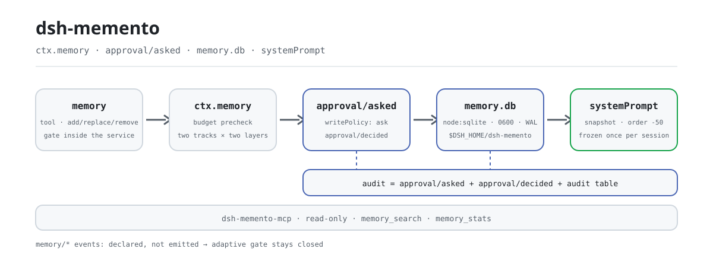
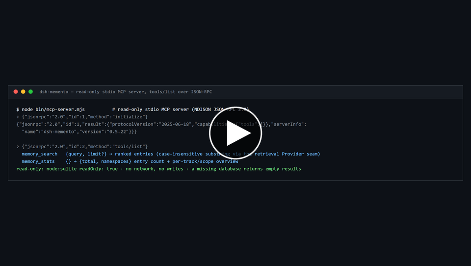

<div align="center">

<picture>
  <source media="(prefers-color-scheme: dark)" srcset="docs/assets/dsh-memento-flow-dark.svg">
  
</picture>

# dsh-memento

**सत्रों के पार याद रखें, और हर लिखावट एक अनुमोदन द्वार व ऑडिट रास्ते के पीछे।**

एक टाइप्ड `ctx.memory` सीम, स्थानीय SQLite प्रोवाइडर, `memory` टूल और फ़्रोज़न स्नैपशॉट इंजेक्शन: बाकी मेमोरी प्लगइन गोदाम बेचते हैं, यह प्लगइन सीम, लेखन-अनुमोदन द्वार और सत्र लॉग से पुनर्निर्मेय ऑडिट बेचता है।

[इंस्टॉल](#तीन-चरणों-में-शुरुआत) · [कॉन्फ़िगरेशन](#कॉन्फ़िगरेशन) · [FAQ](#faq) · [简体中文](README.md) · [English](README.en.md) · [Español](README.es.md) · [Português](README.pt.md) · [हिन्दी](README.hi.md)

[](LICENSE)
[](#संगतता)
[](https://www.npmjs.com/package/dsh-memento)
[](https://github.com/PerryLink/dsh-memento/actions/workflows/ci.yml)
[](#संगतता)

[](https://github.com/PerryLink/dsh-memento/stargazers)
[](https://www.npmjs.com/package/dsh-memento)
[](https://dshfind.com/plugins/PerryLink/dsh-memento?ref=badge)
[](https://securityscorecards.dev/viewer/?uri=github.com/PerryLink/dsh-memento)
[](https://dsh.market/)
[](https://gitee.com/perrylink/dsh-memento)

```sh
dsh plugin --profile <name> add dsh-memento
```

</div>

<sub>सामुदायिक प्लगइन, DeepSeek से असंबद्ध। कैनोनिकल रिपॉज़िटरी: <https://github.com/PerryLink/dsh-memento> (Gitee एक मिरर है)।</sub>

## यह क्या है

कोई याद रखने योग्य बात लिखिए और वह अगले सत्र की शुरुआत में मॉडल का इंतज़ार करती मिलेगी — और वह लिखावट एक अनुमोदन द्वार से गुज़री और एक ऑडिट पंक्ति छोड़ गई। `dsh-memento` DeepSeek Harness को **क्षमता सीम** देता है, कोई दूसरा मेमोरी गोदाम नहीं: एक टाइप्ड `ctx.memory` सेवा, स्थानीय SQLite प्रोवाइडर (`node:sqlite`, WAL, `0600`, डिफ़ॉल्ट `$DSH_HOME/dsh-memento/memory.db`) और उसके दो उपभोक्ता — `memory` टूल और सिस्टम प्रॉम्प्ट में इंजेक्ट होने वाला फ़्रोज़न स्नैपशॉट। दो ट्रैक (`user` / `agent`) × दो परतें (`user-global` / `workspace`) × प्रति `agentPreset` कुंजी, प्रति ट्रैक-परत कठोर वर्ण बजट के साथ; `dsh-memento-mcp` एक केवल-पढ़ने वाला stdio MCP प्रवेश भी देता है।

**यह भी देखें।** `dsh-mnemon` mem0/Honcho होस्टेड प्रोवाइडर वाला framework है, 0.2.1 लाइन पर पिन; `@openviking/dsh-memory-plugin` Volcengine का उदाहरण है जिसमें dsh engine घोषित नहीं; `dsh-plugin-memory` प्रकार में सबसे निकट है और उसकी कोई provenance नहीं। `dsh-memento` स्थानीय SQLite + अनुमोदन द्वार + ऑडिट श्रृंखला है, होस्टेड प्रोवाइडर का drop-in नहीं।

## तीन चरणों में शुरुआत

1. **इंस्टॉल** (कोई एक चैनल चुनें):

   ```sh
   # git चैनल (नवीनतम main; git+https://github.com/PerryLink/dsh-memento.git के बराबर)
   dsh plugin --profile web add github:PerryLink/dsh-memento
   # npm चैनल (प्रकाशित रिलीज़)
   dsh plugin --profile web add dsh-memento
   # tarball चैनल: इस रेपो में npm pack के बाद
   dsh plugin --profile web add ./dsh-memento-<version>.tgz
   ```

   कोई build चरण नहीं — `index.mjs`, `lib/` और `client/` ही भेजे गए आर्टिफ़ैक्ट हैं।

2. **न्यूनतम कॉन्फ़िग** (डिफ़ॉल्ट पहले से काम करते हैं; यह सिर्फ़ लेखन नीति और बजट स्पष्ट करता है):

   ```yaml
   - insert:
       - id: memento
         name: dsh-memento
         config:
           writePolicy: ask
           budgets:
             user:
               userGlobal: 2000
               workspace: 2000
             agent:
               userGlobal: 4000
               workspace: 4000
   ```

3. **सत्यापित करें कि यह सक्रिय है**:

   ```sh
   dsh --profile web --dump-config | grep -A3 'id: memento'
   ```

   ```
   > /memory budgets
   > /memory list
   ```

**अनइंस्टॉल**: `dsh plugin --profile web remove dsh-memento` (मेमोरी डेटाबेस और सत्र लॉग रखे जाते हैं)।

<details>
<summary>DSH Desktop मार्केट से इंस्टॉल</summary>

हर PerryLink प्लगइन DSH Desktop के अंतर्निहित मार्केट में सूचीबद्ध है: **मार्केट → स्रोत → स्रोत जोड़ें → पेस्ट करें** `https://perrylink-dsh-catalog.perrylink.workers.dev/catalog-source.json` **→ चुनें**। इंस्टॉल अब भी मार्केट के npm पहचान सत्यापन और आपकी पुष्टि से होता है।

</details>

*वही रन, एनिमेटेड।*

[](https://github.com/PerryLink/dsh-memento/blob/main/docs/assets/dsh-memento-demo.mp4)

*▶ **2 मिनट 23 सेकंड का नैरेटेड वॉकथ्रू** — थंबनेल MP4 फ़ाइल खोलता है; अगर पेज पर न चले तो वहाँ *Download raw file* इस्तेमाल करें ([MP4, 1.87 MB](https://github.com/PerryLink/dsh-memento/blob/main/docs/assets/dsh-memento-demo.mp4) · [सीधा डाउनलोड](https://raw.githubusercontent.com/PerryLink/dsh-memento/main/docs/assets/dsh-memento-demo.mp4))। GitHub README फ़ाइलों से `<video>` टैग हटा देता है, इसलिए वीडियो खोलने की फ़ाइल है, इनलाइन एम्बेडेड नहीं।*

## मुख्य क्षमताएँ

`dsh-memento` अनुमोदन द्वार को **सेवा के भीतर** लागू करता है, प्रमाण **सत्र लॉग** में छोड़ता है, और भरे हुए स्टोर को त्रुटि मानता है — लिखने का न्योता नहीं:

- **अनुमोदन द्वार को टाला नहीं जा सकता।** हर लेखन पथ (`add` / `replace` / `remove` / `seed`) सेवा के भीतर अनुमोदन वॉटरफ़ॉल से होकर गुज़रता है, टूल परत से नहीं। `writePolicy: ask | auto | off` मॉडल के लिए अदृश्य विन्यास है; `replace` / `remove` / `consolidate` अनुमोदन पेलोड में बदली जाने वाली प्रविष्टियों का पूरा पाठ ले जाते हैं, और अस्वीकृत लेखन भी एक `*-denied` ऑडिट पंक्ति छोड़ता है।
- **मॉडल-दृश्य ⟺ लॉग किया गया।** इंजेक्ट किया गया स्नैपशॉट `system/message` में शब्दशः पहुँचता है; हर लेखन `approval/asked` + `approval/decided` + प्लगइन की अपनी ऑडिट तालिका से पुनर्निर्माण-योग्य है।
- **सीमित और ईमानदार।** प्रति ट्रैक/परत कड़े कैरेक्टर बजट (डिफ़ॉल्ट user 2000 / agent 4000)। भरा हुआ स्टोर संरचित त्रुटि देता है (उपयोग + सीमा) — कभी काटता नहीं, कभी स्वतः संकुचित नहीं करता।
- **ऑडिट की कमी दिखती है।** `/memory audit` प्लगइन की ऑडिट तालिका दिखाता है और जब सेशन लॉग वाला पक्ष नहीं लिखा जाता तो एक पंक्ति जोड़ता है: यह होस्ट `memory/*` सेशन इवेंट प्रकार नहीं जानता, और अज्ञात प्रकार जोड़ने से वह सेशन दोबारा लोड ही नहीं होगा, इसलिए लेख `approval/asked` + `approval/decided` और प्लगइन की तालिका से ऑडिट होते हैं। द्वार अनुकूली है — होस्ट इन प्रकारों को जानते ही यह पंक्ति स्वयं हट जाती है।

दो ट्रैक × दो परतें × प्रति-एजेंट कुंजी: एक `user` ट्रैक (उपयोगकर्ता के बारे में तथ्य) और एक `agent` ट्रैक (पर्यावरण तथ्य और परंपराएँ), प्रत्येक `user-global` और `workspace` परतों में बँटा, `agentPreset` के अनुसार पृथक। स्नैपशॉट पहले प्रॉम्प्ट संयोजन पर प्रति-सत्र एक बार फ़्रीज़ होता है और सत्र के बीच कभी नहीं बदलता।

### टूल और कमांड सतह

| सतह | प्रकार | नोट्स |
|---|---|---|
| `memory` | टूल | Save/Skip मार्गदर्शन के साथ add/replace/remove/consolidate/query; लेखन अनुमोदन द्वार से गुज़रता है |
| `memory_recall` | टूल | परिबद्ध मेमोरी मिलान + हाल के सत्र-इतिहास मिलान |
| `/memory` | कमांड | `list` · `query` · `add` · `remove` · `consolidate` · `proposals` · `budgets` · `audit` · `export` · `import <path>` · `adapters` |
| वेब पैनल | क्लाइंट ड्रॉअर | केवल-पठन: प्रविष्टियाँ ब्राउज़ करें, खोजें, बजट बार, ऑडिट पूँछ; फ़्लोटिंग बटन छिपाया जा सकता है (`panel.enabled`) |
| सेटिंग्स अनुभाग | DSH सेटिंग्स साइडबार → `dsh-memento` | फ़ाइल छुए बिना सभी कॉन्फ़िग फ़ील्ड संपादित करें (`enabled` को छोड़कर; `0.1.7` लाइन पर namespace = `memento` प्रोफ़ाइल प्रविष्टि, उससे पहले `dsh-memento` सेटिंग्स namespace); लाइव/रीलोड समय पृष्ठ पर अंकित |

### उदाहरण

#### विस्तृत उदाहरण

**कमांड**

~~~sh
memory_stats
~~~

**इनपुट**

~~~json
{"jsonrpc":"2.0","id":7,"method":"tools/call","params":{"name":"memory_stats","arguments":{}}}
~~~

**आउटपुट**

~~~text
{
  "total": 3,
  "namespaces": [
    {
      "track": "agent",
      "scope": "user-global",
      "count": 1
    },
    {
      "track": "agent",
      "scope": "workspace",
      "count": 1
    },
    {
      "track": "user",
      "scope": "workspace",
      "count": 1
    }
  ]
}
~~~

*स्रोत `test/mcp.test.mjs:108-118 (fixture seed at 21-27); README.md:160-176`*

#### विफलता शाखा

**इनपुट**

~~~text
{"jsonrpc":"2.0","id":10,"method":"tools/call","params":{"name":"memory_search","arguments":{}}}
~~~

**आउटपुट**

~~~text
{"jsonrpc":"2.0","id":10,"result":{"content":[{"type":"text","text":"invalid arguments: query must be a non-empty string"}],"isError":true}}
~~~

*स्रोत `plugins/dsh-memento/lib/mcp.mjs:188; plugins/dsh-memento/test/mcp.test.mjs:126-127; reproduced via plugins/dsh-memento/bin/mcp-server.mjs`*

#### संक्षिप्त उदाहरण

- `/memory`

### MCP सर्वर

`dsh-memento` एक केवल-पठन stdio **MCP सर्वर** (`dsh-memento-mcp`) भी देता है ताकि बाहरी MCP क्लाइंट (Claude, Codex, …) बिना harness के मेमोरी स्टोर खोज सकें। यह newline-delimited JSON (NDJSON) पर JSON-RPC 2.0 बोलता है — प्रति पंक्ति एक JSON ऑब्जेक्ट, कोई `Content-Length` फ़्रेमिंग नहीं।

**केवल-पठन।** डेटाबेस `node:sqlite` के `readOnly: true` से खुलता है (कोई माइग्रेशन नहीं, कोई WAL लेखन नहीं, recall-count में वृद्धि नहीं); अगर फ़ाइल मौजूद नहीं है तो क्रैश के बजाय खाली परिणाम मिलते हैं।

| टूल | उद्देश्य |
|---|---|
| `memory_search` | `{query, limit?}` → क्रमबद्ध प्रविष्टियाँ (retrieval Provider seam से केस-इनसेंसिटिव सबस्ट्रिंग) |
| `memory_stats` | `{}` → `{total, namespaces}` प्रविष्टि गणना + track/scope अवलोकन |

सीधे चलाएँ:

```sh
node bin/mcp-server.mjs
# या, npm install के बाद: npx dsh-memento-mcp
```

डेटाबेस पथ `$DSH_MEMENTO_DB_PATH` है (निरपेक्ष, या `$DSH_HOME` के सापेक्ष); डिफ़ॉल्ट `$DSH_HOME/dsh-memento/memory.db`।

Claude Desktop (`claude_desktop_config.json`) उदाहरण:

```json
{
  "mcpServers": {
    "dsh-memento": {
      "command": "npx",
      "args": ["-y", "dsh-memento-mcp"],
      "env": {
        "DSH_MEMENTO_DB_PATH": "/home/you/.dsh/dsh-memento/memory.db"
      }
    }
  }
}
```

सर्वर केवल-पठन है: कोई नेटवर्क नहीं, कोई लेखन नहीं, कोई अनुमोदन द्वार नहीं — केवल खोज और आँकड़े।

### dsh-memory-protocol v1

`dsh-memento` DSH मेमोरी प्रोटोकॉल का सामुदायिक पूर्वाभ्यास है — एक आधिकारिक `ctx.memory` सीम के लिए उम्मीदवार आकार। यह प्रोटोकॉल इस प्लगइन की सीम को एक क्रॉस-प्लगइन अनुबंध में सामान्य करता है:

- **Entry spec** — दो ट्रैक × दो परतें × प्रति-एजेंट कुंजी, साथ ही छोटे `tags` (≤16 × ≤32 अक्षर) और प्रति-प्रविष्टि `version` जो हर `replace` पर बढ़ता है।
- **Write semantics** — इडेम्पोटेंट अद्वितीय-सबस्ट्रिंग सशर्त लेखन; जो-दिखे-वही-स्वीकृत पेलोड (`replace` / `remove` / `consolidate` बदले जाने वाला पूरा पाठ ले जाते हैं)।
- **Audit contract** — हर लेखन `approval/asked` + `approval/decided` + प्रदाता खाता-बही से पुनर्निर्माण-योग्य।
- **Budget model** — `BUDGET_EXCEEDED` / `AMBIGUOUS_MATCH` अर्थविज्ञान।
- **Schema versioning** — ज़ोरदार संस्करण जाँच वाले प्रवासन नियम।

- **Spec** — [docs/protocol-v1.md](docs/protocol-v1.md) (चीनी: [protocol-v1.zh.md](docs/protocol-v1.zh.md)); मानक JSON Schema [docs/schemas/dsh-memory-protocol-v1.schema.json](docs/schemas/dsh-memory-protocol-v1.schema.json) पर।

**Adapter registry** — `ctx.memoryAdapters` (`register` / `list` / `adapt` / `export`) तृतीय-पक्ष मेमोरी प्लगइन को एक शुद्ध डेटा कन्वर्टर पंजीकृत करके प्रोटोकॉल बोलने देता है (उत्क्रमणीय `register()`; आयात अनुमोदन-द्वारी `seed` पर चलता है, निर्यात केवल-पठन है)। ऑनबोर्डिंग: [docs/adapters-guide.md](docs/adapters-guide.md) (चीनी: [adapters-guide.zh.md](docs/adapters-guide.zh.md))।

| अंतर्निहित अडैप्टर | बाहरी फ़ॉर्मैट | नोट्स |
|---|---|---|
| `mem0` | mem0 तथ्य संग्रह (`{facts: [{memory, metadata?}]}`) | `metadata.category` / `metadata.tags` tags बनते हैं; कच्चे `messages` ऐरे अस्वीकृत — एडेप्टर परिवर्तित करते हैं, कभी निष्कर्षण नहीं |
| `hermes-memory-md` | Hermes `memory.md` (`## section` + बुलेट) | अनुभाग नाम tags बनते हैं; बिना बुलेट वाला गद्य ज़ोर से विफल होता है |
| `claude-code-memory-md` | `CLAUDE.md`-शैली markdown (शीर्षक, बुलेट, अनुच्छेद) | बुलेट और अनुच्छेद प्रविष्टियाँ बनते हैं; अनुभाग नाम tags बनते हैं |

**Conformance suite** — [test/protocol-conformance/](test/protocol-conformance/README.md): एक वितरण-योग्य केस-सेट जिसे संगतता का दावा करने वाला कोई भी प्रदाता चलाता है (`node test/protocol-conformance/run.mjs --provider ./your-factory.mjs`); इस रेपो का CI इसे अपने प्रदाता के विरुद्ध स्वर्ण संदर्भ के रूप में चलाता है (`npm run test:conformance`)।

- **Upstream proposal** — [docs/upstream-proposal.md](docs/upstream-proposal.md) (चीनी: [upstream-proposal.zh.md](docs/upstream-proposal.zh.md)): आधिकारिक `ctx.memory` सीम को प्रोटोकॉल क्यों अपनाना चाहिए, अंतर और प्रवासन पथ।

### अन्य मेमोरी प्लगइनों से अंतर

| प्लगइन | यह क्या है | dsh-memento का अंतर |
|---|---|---|
| dsh-memory-evolve | मेमोरी वेयरहाउस / इवोल्यूशन लूप | टाइप्ड सेवा सीम, अनुमोदन द्वार और सत्र-लॉग ऑडिट; कोई वेयरहाउस महत्वाकांक्षा नहीं |
| dsh-mnemon | मेमोरी स्टोर सहायक | प्रोटोकॉल + द्वार + ऑडिट, कोई दूसरा स्टोर नहीं |
| dsh-kb-sieve | ज्ञान-आधार छानना | कोई रिट्रीवल इंजीनियरिंग नहीं: छोटे-कोर्पस सबस्ट्रिंग खोज, `session_search`/`sessionQuery` से क्रॉस-सेशन रिकॉल |
| dsh-tdai-memory | कार्य-संचालित मेमोरी टूलिंग | बजट प्रति track×परत और सेवा में लागू, न कि सर्वोत्तम-प्रयास |
| claude-bridge | Claude Code ब्रिजिंग | DSH-नेटिव; भविष्य का `seed(source:'claude')` पथ एक ब्रिज को वही स्टोर भरने देता है |
| dsh-external/Recall | बाहरी एजेंट मेमोरी | स्थानीय-प्रथम, शून्य-नेटवर्क, DSH की अपनी अनुमोदन सीम पर चलता है |
| Official MCP memory examples | DSH की घोषित "मेमोरी = बाहरी MCP" स्थिति | **नेटिव फर्स्ट-पार्टी** पूरक: समान लक्ष्य, कोई बाहरी सर्वर नहीं; दोनों सह-अस्तित्व |

नाम **`dsh-memento`** है (npm और GitHub पर प्रकाशित)। `dsh-recall` नहीं (dsh-external/Recall से भ्रमित होने वाला), न ही हटाया गया विरासत नाम `dsh-memory`।

### टर्मिनल मेमोरी से हमने क्या सीखा

`dsh-memento` Claude Code, Codex या Hermes का पोर्ट नहीं है — लेकिन इसके डिज़ाइन ने जान-बूझकर वह अपनाया जो प्रत्येक ने सही किया, और वह अस्वीकार किया जो नुकसान करता था:

| टर्मिनल मेमोरी | क्या सही किया | dsh-memento ने क्या अपनाया |
|---|---|---|
| **Claude Code** — `CLAUDE.md` | पदानुक्रमित सादा-पाठ मेमोरी फ़ाइलें (उपयोगकर्ता-स्तर → परियोजना-स्तर), मानव-पठनीय और संपादन-योग्य, हर सत्र में स्वतः मर्ज | सादा-पाठ प्रविष्टियाँ; `user-global` / `workspace` परतें प्रति-सत्र मर्ज; एक भंडार जिसे आप ब्राउज़, `export` और ऑडिट कर सकते हैं — पारदर्शिता एक विशेषता के रूप में |
| **Codex** — `AGENTS.md` | प्रति-निर्देशिका स्कोप्ड निर्देश स्वतः खोजे और शून्य मॉडल घर्षण से इंजेक्ट | सत्र cwd से अनुक्रमित `workspace` परत (Windows केस-असंवेदी); सत्र आरंभ पर स्वतः इंजेक्ट फ़्रोज़न स्नैपशॉट |
| **Hermes** — `memory.md` | सक्रिय मेमोरी सेव और यह सुरक्षा सबक कि केवल टूल परत पर लागू द्वार देर से टूल-इंजेक्शन से टाला जा सकता है | Save/Skip मार्गदर्शन वाला `memory` टूल + अनुमोदन-द्वारी स्वतः-कैप्चर प्रस्ताव; द्वार `ctx.memory` के लेखन तरीकों के भीतर रहता है, टूल परत में नहीं |

स्रोत: [Claude Code memory](https://code.claude.com/docs/en/memory) · [Codex AGENTS.md](https://developers.openai.com/codex/cli/agents-md) · [Hermes memory](https://github.com/NousResearch/hermes-agent/blob/main/website/docs/user-guide/features/memory.md) · [Hermes #48181](https://github.com/NousResearch/hermes-agent/issues/48181)।

और जान-बूझकर अस्वीकार किए गए भाग: मॉडल-निजी स्थिति में छिपा स्व-सारांशीकरण (यहाँ संघनन सारांश **लंबित प्रस्ताव** बनते हैं जो मानव approve/dismiss की प्रतीक्षा करते हैं), भंडार/वेक्टर-स्टोर महत्वाकांक्षाएँ, और बिना मानव-दृश्य अनुमोदन या ऑडिट ट्रेल वाला कोई भी लेखन। यह भी अपनाया गया: Hermes की दस्तावेज़ित चेतावनी कि एक ही होम निर्देशिका साझा करने वाली दो प्रक्रियाएँ एक ही मेमोरी फ़ाइल लिखती हैं — सुरक्षा सीमाएँ देखें।

## कॉन्फ़िगरेशन

सभी ट्यूनिंग Schemastery `Config` फ़ील्ड हैं (cordis.yml से बदले जा सकते हैं); अमान्य मान लोड पर ज़ोर से विफल होते हैं। id-आधारित ओवरराइड पूरी पंक्ति बदल देता है — जिन कुंजियों की ज़रूरत हो, सब दोहराएँ। `cordis.patch.yml` bundle घोषणा है, और उस पंक्ति का `id` (`memento`) ही सेटिंग्स फ़ॉर्म का namespace भी है।

**सेटिंग्स पैनल।** `0.1.7` लाइन पर प्लगइन का अपना `Config` ही उसका सेटिंग्स पृष्ठ **है**: फ़ॉर्म का namespace प्रोफ़ाइल प्रविष्टि की id (`memento`, यानी इस bundle की पंक्ति का `id:`) है, संपादन-योग्य फ़ील्ड ठीक वही हैं जिन्हें प्लगइन `.volatile()` घोषित करता है (नीचे के सभी कुंजी, `enabled` को छोड़कर), और स्वीकृत संपादन प्रोफ़ाइल की प्लगइन पंक्ति में मिल जाता है और चल रहे प्लगइन में लागू होता है — फ़ाइल छूने या पुनः आरंभ की ज़रूरत नहीं। लगभग सब लाइव लागू होते हैं (राइट पॉलिसी, भाषा, बजट, सीमाएँ, प्रस्ताव, पैनल; `dbPath` / `auditRetentionDays` स्टोर पुनः खोलकर; `retrieval.vector` रिट्रीवर बदलकर); लोड के समय पंजीकृत चीज़ें (`snapshotOrder`, टूल विवरण) रीलोड पर पढ़ी जाती हैं और पृष्ठ उन फ़ील्ड पर निशान लगाता है। संख्यात्मक सीमाएँ schema में भी घोषित हैं, इसलिए सीमा से बाहर का संपादन लिखने के समय ही अस्वीकार हो जाता है, बजाय एक अनुपयोगी कॉन्फ़िग छोड़ने के। पुरानी लाइनों (`0.1.2-rc.1`, `0.1.5-alpha.1`, `0.1.6-0`) पर वही कार्ड `dsh-memento` सेटिंग्स namespace संपादित करता है, पहले जैसा; सेटिंग्स सेवा पूरी तरह अनुपस्थित हो तो सब कुछ संयुक्त cordis कॉन्फ़िग पर लौटता है। फ़्लोटिंग पैनल बटन उसी पृष्ठ से छिपाया जा सकता है (`panel.enabled`)।

सबसे अधिक उपयोग होने वाली कुंजियाँ:

| कुंजी | डिफ़ॉल्ट | अर्थ |
|---|---|---|
| `enabled` | `true` | मुख्य स्विच; `false` सेवा, टूल, स्नैपशॉट, कमांड, पैनल और answerer हटा देता है (सेटिंग्स पृष्ठ से संपादन योग्य नहीं — अक्षम प्लगइन की कोई सेटिंग्स प्रविष्टि नहीं) |
| `panel.enabled` | `true` | वेब पैनल का फ़्लोटिंग बटन दिखाएँ; सेटिंग्स पृष्ठ से `false` सेव करने पर 🧠 प्रविष्टि तुरंत छिप जाती है, रीलोड की ज़रूरत नहीं (सेटिंग्स पृष्ठ अप्रभावित) |
| `dbPath` | `''` → `$DSH_HOME/dsh-memento/memory.db` | निरपेक्ष, या `$DSH_HOME` के सापेक्ष (Windows पर `~/.dsh` पर फ़ॉलबैक) |
| `budgets.user.userGlobal` | `2000` | user ट्रैक की user-global परत का कठोर अक्षर बजट |
| `writePolicy` | `'ask'` | डिफ़ॉल्ट लेखन नीति: `ask` / `auto` / `off` (मॉडल-अदृश्य) |
| `language` | `'en'` | मॉडल-दृश्य और कमांड आउटपुट भाषा: `en` / `zh` |
| `retrieval.vector` | `false` | सिमेंटिक रिकॉल स्विच: `true` से `memory_recall` वेक्टर रिकॉल (फ़ेक हैश एम्बेडिंग) सक्षम होता है जब कोई एम्बेडिंग प्रदाता उपलब्ध हो; अन्यथा सबस्ट्रिंग पर डिग्रेड होता है |

<details>
<summary>पूरी कॉन्फ़िगरेशन तालिका (25 कुंजियाँ)</summary>

| कुंजी | डिफ़ॉल्ट | अर्थ |
|---|---|---|
| `enabled` | `true` | मुख्य स्विच; `false` सेवा, टूल, स्नैपशॉट, कमांड, पैनल और answerer हटा देता है (सेटिंग्स पृष्ठ से संपादन योग्य नहीं — अक्षम प्लगइन की कोई सेटिंग्स प्रविष्टि नहीं) |
| `panel.enabled` | `true` | वेब पैनल का फ़्लोटिंग बटन दिखाएँ; सेटिंग्स पृष्ठ से `false` सेव करने पर 🧠 प्रविष्टि तुरंत छिप जाती है, रीलोड की ज़रूरत नहीं (सेटिंग्स पृष्ठ अप्रभावित) |
| `dbPath` | `''` → `$DSH_HOME/dsh-memento/memory.db` | निरपेक्ष, या `$DSH_HOME` के सापेक्ष (Windows पर `~/.dsh` पर फ़ॉलबैक) |
| `budgets.user.userGlobal` | `2000` | user ट्रैक की user-global परत का कठोर अक्षर बजट |
| `budgets.user.workspace` | `2000` | user ट्रैक की workspace परत का कठोर अक्षर बजट |
| `budgets.agent.userGlobal` | `4000` | agent ट्रैक की user-global परत का कठोर अक्षर बजट |
| `budgets.agent.workspace` | `4000` | agent ट्रैक की workspace परत का कठोर अक्षर बजट |
| `writePolicy` | `'ask'` | डिफ़ॉल्ट लेखन नीति: `ask` / `auto` / `off` (मॉडल-अदृश्य) |
| `writePolicies` | `{}` | प्रति-ट्रैक/स्कोप या प्रति-स्रोत ओवरराइड (जैसे `user/workspace`, `source:claude`) |
| `language` | `'en'` | मॉडल-दृश्य और कमांड आउटपुट भाषा: `en` / `zh` |
| `snapshotOrder` | `-50` | स्नैपशॉट अनुभाग क्रम (harness पहचान के बाद, persona से पहले) |
| `maxEntriesPerQuery` | `20` | डिफ़ॉल्ट प्रति-क्वेरी परिणाम सीमा (कठोर सीमा 1000) |
| `commandListLimit` | `50` | प्रति `/memory list` / `query` प्रदर्शित प्रविष्टियाँ |
| `commandAuditLimit` | `10` | प्रति `/memory audit` प्रदर्शित ऑडिट पंक्तियाँ |
| `recall.historyLimitDefault` | `8` | `memory_recall` द्वारा डिफ़ॉल्ट स्कैन किए गए सत्र |
| `recall.snippetCap` | `5` | `memory_recall` में प्रति-सत्र स्निपेट |
| `recall.snippetChars` | `300` | `memory_recall` स्निपेट अक्षर |
| `recall.windowDays` | `30` | `memory_recall` की दिनों में हाल-समय विंडो |
| `retrieval.vector` | `false` | सिमेंटिक रिकॉल स्विच: `true` से `memory_recall` वेक्टर रिकॉल (फ़ेक हैश एम्बेडिंग) सक्षम होता है जब कोई एम्बेडिंग प्रदाता उपलब्ध हो; अन्यथा सबस्ट्रिंग पर डिग्रेड होता है |
| `panelEntriesLimit` | `200` | वेब पैनल प्रविष्टि पृष्ठ आकार |
| `panelAuditLimit` | `20` | वेब पैनल डिफ़ॉल्ट ऑडिट पंक्तियाँ |
| `auditRetentionDays` | `0` | ऑडिट अवधारण (0 = हमेशा रखें) |
| `proposals.enabled` | `true` | हर सफल संघनन के बाद स्वतः एक मेमोरी प्रस्ताव कैप्चर करें |
| `proposals.maxChars` | `2000` | प्रस्ताव अक्षर सीमा |
| `proposals.maxPending` | `8` | लंबित प्रस्ताव सीमा |

</details>

अपने प्रोफ़ाइल patch में ओवरराइड का उदाहरण:

```yaml
- insert:
    - id: memento
      name: dsh-memento
      config:
        writePolicy: auto
        retrieval:
          vector: true
        language: en
```

## FAQ

<details>
<summary>मेमोरी असल में कहाँ रहती है? क्या वह सत्र लॉग के साथ चली जाती है?</summary>

डिफ़ॉल्ट रूप से स्थानीय `$DSH_HOME/dsh-memento/memory.db` में (`node:sqlite`, WAL, POSIX `0600`) — शून्य नेटवर्क, शून्य क्रेडेंशियल। सत्र लॉग में न डेटाबेस जाता है न उसकी सामग्री: **मॉडल में इंजेक्ट होने वाला स्नैपशॉट पाठ** शब्दशः `system/message` में और एक `audit(snapshot)` पंक्ति में जाता है — यह «मॉडल को दिखे ⟺ लॉग हो» की गारंटी है, लीक नहीं; स्टोर आपकी मशीन से बाहर नहीं जाता। अनइंस्टॉल करने पर डेटाबेस और सत्र लॉग दोनों रहते हैं।

</details>

<details>
<summary>अगर होस्ट `memory/*` सत्र इवेंट प्रकार नहीं जानता तो ऑडिट टूट जाता है?</summary>

नहीं — बस श्रृंखला बदल जाती है। `0.2.1-alpha.2` तक `KNOWN_SESSION_EVENT_TYPES` में `memory/*` नहीं है, और अपंजीकृत प्रकार जोड़ने से वह सत्र अगली बार लोड ही नहीं होगा, इसलिए रनटाइम द्वार बंद रहता है: ऑडिट `approval/asked` + `approval/decided` जोड़ी और प्लगइन की अपनी `audit` तालिका से बनता है, सत्र-लॉग पक्ष छूटने पर `/memory audit` एक पंक्ति जोड़ता है, और प्रक्रिया में एक बार चेतावनी आती है। द्वार अनुकूली है — होस्ट ये प्रकार दर्ज करते ही अपने आप खुल जाता है, कोड बदलने की ज़रूरत नहीं। `ask` नीति भी वैसे ही बंद-विफल होती है: answerer न होने पर लिखावट चुपचाप मंज़ूर होने के बजाय अस्वीकृत होती है।

</details>

<details>
<summary>क्या यह दूसरे प्लगइनों से टूल नाम, सेवा कुंजी या slot के लिए टकराता है?</summary>

नहीं। सभी टूल namespaced हैं; यह चार सेवा कुंजियाँ देता है (`memory`, `memoryAdapters`, `memoryEmbedding`, `memoryRetrieval`), इनमें कोई अंतर्निहित seam नहीं; कोई क्लाइंट slot या `webServer` उपसर्ग पंजीकृत नहीं करता, किसी अंतर्निहित पंक्ति का `config` कभी नहीं लिखता, और globals नहीं बदलता। बिंदु-दर-बिंदु तर्क «अन्य DSH प्लगइनों के साथ इंटरऑपरेबिलिटी» में है।

</details>

<details>
<summary>भरा हुआ स्टोर चुपचाप कट जाता है? खर्च कितना है?</summary>

दोनों नहीं। बजट सेवा में दो बार जाँचा जाता है (अनुमोदन से पहले और बाद); भरा स्टोर संरचित `BUDGET_EXCEEDED` फेंकता है (used / limit / needed के साथ) ताकि मॉडल समेकित या हटाकर फिर कोशिश करे — कभी कटता नहीं, कभी अपने आप संक्षिप्त नहीं होता। अस्पष्ट substring मिलान `AMBIGUOUS_MATCH` फेंकता है। खर्च की ओर: प्रोवाइडर एकल-कनेक्शन सिंक्रोनस SQLite है, कोई नेटवर्क नहीं, कोई मॉडल कॉल नहीं, और स्नैपशॉट प्रति सत्र एक बार रेंडर होकर फ़्रीज़ हो जाता है, इसलिए सिस्टम प्रॉम्प्ट उपसर्ग सत्र के भीतर स्थिर रहता है (prefix-cache अनुकूल)।

</details>

## सुरक्षा सीमाएँ

- **केवल सार्वजनिक सेवाएँ।** `tools`, `systemPrompt` और अनुमोदन सीम का उपभोग करता है; engine / agent-loop / apiproxy / आधिकारिक UI में कोई बदलाव नहीं।
- **शून्य नेटवर्क, शून्य क्रेडेंशियल।** POSIX फ़ाइल मोड `0600` वाला स्थानीय डेटाबेस।
- **ज़ोर से विफल।** दूषित DB, नया स्कीमा या अमान्य विन्यास लोड पर विफल होता है; भरे बजट और अस्पष्ट सबस्ट्रिंग मिलान संरचित त्रुटियों से विफल होते हैं।
- **एक प्रक्रिया, एक भंडार।** कई सत्र SQLite भंडार साझा करते हैं; एक ही `$DSH_HOME` साझा करने वाली दो प्रक्रियाएँ एक ही फ़ाइल लिखती हैं (SQLite लॉकिंग के तहत अंतिम-लेखक-जीत)।

## अनुमतियाँ और डेटा

- **अनुमतियाँ**: workshop मैनिफ़ेस्ट `harness:tool`, `filesystem:read`, `filesystem:write` और `network:none` / `subprocess:none` / `shell:none` / `python:none` / `credentials:none` घोषित करता है। लेखन अनुमोदन आधिकारिक अनुमोदन सीम पर चलता है।
- **डेटा**: स्थानीय SQLite डेटाबेस (`0600`), शून्य नेटवर्क, शून्य क्रेडेंशियल।
- **सत्र लॉग**: ऑडिट पूर्णता अनुमोदन जोड़ी (`approval/asked` + `approval/decided`) और प्लगइन की अपनी ऑडिट तालिका से आती है; सेशन लॉग वाली कमी `/memory audit` में घोषित होती है और होस्ट के `memory/*` दर्ज करते ही हट जाती है।

## ज्ञात सीमाएँ

- **सत्र घटनाएँ घोषित हैं, अभी उत्सर्जित नहीं (rc.2)।** `memory/added|updated|removed|recalled|snapshot` मर्ज-घोषित हैं, परंतु rc.2 में रेपो-बाहर घटना प्रकारों के लिए कोई पंजीकरण सतह नहीं है; harness बिल्ड उन्हें पंजीकृत करते ही उत्सर्जन चालू हो जाता है।
- **`ask` नीति को answerer चाहिए।** बिना UI/ACP answerer के, लेखन बंद-विफल होते हैं।
- **कोई FTS5 अनुक्रमण नहीं।** सबस्ट्रिंग खोज केस-असंवेदी `instr` पर चलती है (CJK के लिए सही)।

## अन्य DSH प्लगइनों के साथ इंटरऑपरेबिलिटी

**DSH `0.2.0-rc.2`** (वह रनटाइम जिसके लिए यह README प्रकाशित है) और 2026-10-05 को सर्वे किए गए उच्च-स्टार प्लगइन सेट के विरुद्ध सत्यापित।

यह प्लगइन अन्य प्लगइनों में **हस्तक्षेप नहीं करता**, उन उच्च-स्टार प्लगइनों सहित जो व्यापक रूप से इंस्टॉल हैं:

- **कोई टूल-नाम टकराव नहीं।** सभी टूल नेमस्पेस युक्त हैं; कोई भी ऐसा नंगा नाम नहीं लेता जो पहले से किसी अंतर्निहित टूल या अन्य प्लगइन का हो।
- **कोई सर्विस-की टकराव नहीं।** यह केवल `memory`, `memoryAdapters`, `memoryEmbedding`, `memoryRetrieval` प्रदान करता है; यह key न अंतर्निहित सीम है और न किसी सर्वे किए गए उच्च-स्टार प्लगइन द्वारा प्रदान की जाती है।
- **कोई स्लॉट टकराव नहीं।** यह कोई क्लाइंट slot key पंजीकृत नहीं करता, इसलिए `shadows-shipped-ui` सीट के लिए प्रतिस्पर्धा नहीं करता।
- **कोई HTTP रूट टकराव नहीं।** यह कोई `webServer` प्रीफ़िक्स पंजीकृत नहीं करता।
- **कोई patch-लेयर टकराव नहीं।** बंडल patch केवल अपनी पंक्ति `insert` करता है; कभी किसी अंतर्निहित पंक्ति का `config` ओवरराइड नहीं करता।
- **कोई वैश्विक परिवर्तन नहीं।** यह प्रोटोटाइप नहीं बदलता, `process.env` नहीं लिखता, और वैश्विक fetch dispatcher प्रतिस्थापित नहीं करता।

**साझा ईवेंट लिसनर रचना से ही अहस्तक्षेपी हैं।** यह क्रम-संवेदनशील ईवेंट `approval/request` को `ctx.on()` से देखता है — Cordis का **ब्रॉडकास्ट** पंजीकरण, जहाँ हर लिसनर चलता है और कोई किसी दूसरे को वंचित नहीं कर सकता। **यहाँ प्रत्येक लिसनर `next()` से डेलिगेट करता है**, इसलिए श्रृंखला कभी शॉर्ट-सर्किट नहीं होती:

स्थैतिक प्रमाण: इस रिपॉज़िटरी पर `dsh-plugin-doctor` के K10–K13 सभी `pass` हैं।

## संगतता

| सतह | स्थिति |
|---|---|
| Harness | DeepSeek Harness `dsh-v0.2.1-alpha.2` (2026-10-12 को अनुकूलित; `0.2.1-alpha.1` 2026-10-04 से): `0.1.7` लाइन ने पूरी सेटिंग्स पंजीकरण सतह (`installSettingsSection` / `SettingsProvider.installSection` / `SettingsNamespace` / `SettingsScope`) को लाइव कॉन्फ़िग फ़ॉर्म से बदल दिया, इसलिए दोनों आधे नया अनुबंध अपनाते हैं — फ़ॉर्म का namespace प्रोफ़ाइल प्रविष्टि की id (`memento`) है, संपादन-योग्य फ़ील्ड `.volatile()` वाले हैं, और स्वीकृत संपादन प्लगइन को रीमाउंट करने के बजाय **चल रहे प्लगइन में** लागू होता है। ब्राउज़र आधा वही फ़ॉर्म `ctx.configForms.get(entryId)` से पढ़ता है (`ctx.settingsScope` सेवा हट चुकी है)। दोनों आधे `installSection` / `settingsScope` शाखाएँ उन `0.1.2-rc.1`, `0.1.5-alpha.1` और `0.1.6-0` लाइनों के लिए बनाए रखते हैं जिन्हें peer रेंज अब भी घोषित करती है, और नई `>=0.1.7-0 <0.2.0` शर्त ही लक्ष्य होस्ट को स्थापित-योग्य बनाती है (पुरानी रेंज semver के प्रीरिलीज़ नियम से उसे बाहर कर देती थी)। प्लगइन इवेंट पंजीकरण सतह अब भी नहीं है — `KNOWN_SESSION_EVENT_TYPES` में `memory/*` नहीं है, और `Session.append` का तीसरा तर्क केवल सरफ़ेस-योग्य प्रकारों के लिए `SurfaceIntent` ले जाता है, इसलिए ऑडिट द्वार अनुकूली रहता है और पहले जैसे छोड़ देता है (यह प्रति प्रोसेस एक बार और `/memory audit` में बताता है)। टाइप प्रमाण तीन फ़ेस से आता है: स्थानीय checkout के बने टाइप, `node_modules` में पिन की गई प्रकाशित लाइन, और DOM लाइब्रेरी के अंतर्गत ब्राउज़र आधा। **`0.2.1-alpha.2` के विरुद्ध पुनः सत्यापित:** इस पैकेज द्वारा छुई जाने वाली हर होस्ट सीम दोनों टैगों के बीच **बाइट-दर-बाइट समान** है (`packages/settings/settings/src/**`, `packages/client/ui-settings/src/**`, `packages/client/ui-slots/src/**`, `packages/client/modules/src/**`, `packages/interaction/user-approval/**`, `vendor/loader/src/**`, `vendor/schemastery/src/**`, `packages/boot/app-boot/src/config-schema/**`), सेशन फ़ॉर्मैट अब भी v4 है और कोई v4→v5 माइग्रेशन नहीं है, तथा `KNOWN_SESSION_EVENT_TYPES` में केवल एक प्रथम-पक्ष प्रकार जुड़ा — इसलिए अनुकूली ऑडिट द्वार बंद ही रहता है और **कोड में कोई बदलाव आवश्यक नहीं था**। जो बदला वह है पिन की गई dev/test लाइन (`0.2.1-alpha.2`, साथ में `pnpm-workspace.yaml` की संबंधित release-age अनुमति-सूची प्रविष्टियाँ) और अनुकूलता बेसलाइन; `npm test` (201 केस, वास्तविक Loader composition सूट सहित), `typecheck:ci`, कवरेज, आर्टिफ़ैक्ट, अनुरूपता और पाँच-भाषा गेट उस पर पास होते हैं। alpha.2 वास्तव में `plugin:<name>/*` नामस्थान वाला `appendPluginRecord` लेखक जोड़ता है, पर होस्ट का अपना `packages/core/session/README.md` रिपॉज़िटरी से बाहर के प्लगइनों को उसे कॉल करने से मना करता है और अनिवार्य `plugin:` उपसर्ग `memory/*` व्यक्त नहीं कर सकता, इसलिए यह पैकेज उसे नहीं अपनाता। |
| Node | `^22.19.0 \|\| >=24.9.0` |
| प्लेटफ़ॉर्म | Windows / macOS / Linux (केवल host; कोई नेटिव कोड नहीं, कोई नेटवर्क नहीं) |
| मॉडल | कोई भी |

## इकोसिस्टम और गुणवत्ता

- [Gitee मिरर](https://gitee.com/perrylink/dsh-memento) (सिंक मिरर; GitHub ही कैनोनिकल है)
- [dshfind प्लगइन पेज](https://dshfind.com/plugins/PerryLink/dsh-memento) (इंस्टॉल और रैंकिंग)
- [OpenSSF Scorecard रिपोर्ट](https://securityscorecards.dev/viewer/?uri=github.com/PerryLink/dsh-memento) ([.github/workflows/scorecard.yml](.github/workflows/scorecard.yml) से संचालित)
- [dsh-plugin-doctor सत्यापन रिपोर्ट](https://github.com/PerryLink/dsh-plugin-doctor#verified-徽章) (K10–K13 सभी `pass`)
- [DSH Market](https://dsh.market/) (सूचीबद्ध)
- **1024 स्टोर चैनल**: एक बार `npm i -g dsh1024`, फिर `dsh1024 plugin --profile web add dsh-memento` ([deepseek1024.com](https://deepseek1024.com) इंस्टॉल रैंकिंग में गिना जाता है)
- [इकोसिस्टम नॉलेज बेस](https://perrylink.github.io/dsh-plugin-guide/) — मापे गए आँकड़े, मार्केटिंग नहीं: प्लगइन डेवलपमेंट गाइड · चयन डेटा · रखरखाव मानदंड

## डेवलपमेंट

```sh
npm install              # node ^22.19 || >=24.9
npm test                 # node --test
npm run lint             # oxlint
npm run test:conformance # dsh-memory-protocol v1 conformance suite
npm run typecheck        # होस्ट फ़ेस × स्थानीय D:\deepseek-harness checkout (checkout न हो तो «सत्यापन असंभव» छापकर exit 0)
npm run typecheck:ci     # होस्ट फ़ेस × node_modules में पिन की गई प्रकाशित लाइन
npm run check:client     # ब्राउज़र आधा (DOM लाइब्रेरी) टाइप गेट
npm run check:coverage   # line-coverage gate
npm run check:readmes    # five-language README consistency gate
npm run verify:self-contained # reject out-of-repo dependency specs
npm run verify:artifacts # artifact presence + syntax + import
```

`lib/` में शून्य DSH निर्भरता है (केवल node: बिल्टइन); DSH आयात केवल `index.mjs` में मौजूद हैं।

README की छवियाँ [`scripts/gen-readme-assets.py`](scripts/gen-readme-assets.py) (Python + Pillow) से प्रोग्रामेटिक रूप में बनती हैं और सुरक्षित रूप से दोबारा चलाई जा सकती हैं।

Topics: `dsh`, `dsh-plugin`, `deepseek-harness`, `memory`, `agent-memory`, `approval`, `audit`, `sqlite`, `cordis`, `llm`

## परिवार और आभार

यह प्रोजेक्ट [PerryLink](https://github.com/PerryLink) के DeepSeek Harness प्लगइन परिवार का हिस्सा है (सभी Apache-2.0)। अगर यह उपयोगी लगे, तो **एक स्टार अगले व्यक्ति को इसे खोजने में मदद करता है** — इसके पीछे कुछ भी लॉक नहीं है।

- [@alone-tree](https://github.com/alone-tree) — DSH सेटिंग्स पैनल प्रविष्टि और छिपाया जा सकने वाला फ़्लोटिंग बटन (#8)।
- [@zzproc](https://github.com/zzproc) — `memory_recall` आउटपुट स्कीमा का `source`/`tags` सुधार (#11)।
- [@Niuniu-Sir](https://github.com/Niuniu-Sir) — [issue #1](https://github.com/PerryLink/dsh-memento/issues/1) में बूट-क्रैश रिपोर्ट, जिससे 0.3.1 में `~/.dsh` फ़ॉलबैक आया।
- [@alex-debap](https://github.com/alex-debap) — **प्रोडक्ट मैनेजर**। इन्होंने कोड नहीं, उत्पाद का आकार संभाला — शुरुआत से पूरी डिज़ाइन-रेखा पर: भंडार नहीं बल्कि सीम होने का प्रस्ताव (एक टाइप्ड `ctx.memory` सीम, न कि एक और मेमोरी भंडार), यह माँग कि राइट-अनुमोदन द्वार सेवा के भीतर लागू हो ताकि मॉडल का कोई रास्ता उसे बायपास न कर सके — टूल-परत का अभ्यास नहीं, और यह ऑडिट गारंटी कि हर लेख अनुमोदन जोड़ी तथा प्लगइन की अपनी ऑडिट तालिका से पुनर्निर्मेय हो। परिबद्ध, स्तरित रिकॉल मॉडल का नामकरण किया — दो ट्रैक × दो परतें, प्रति-एजेंट कुंजी, प्रति-ट्रैक और प्रति-परत कठोर वर्ण बजट — और स्थानीय-प्रथम, शून्य-क्रेडेंशियल भंडारण की वकालत की (`$DSH_HOME` के नीचे `0600` SQLite, कोई नेटवर्क नहीं, कोई कुंजी नहीं)। प्रोटोकॉल कार्य को एक उत्पाद-पंक्ति की तरह आगे बढ़ाया: सार्वजनिक `dsh-memory-protocol` v1 रिहर्सल, उसका Adapter registry और Conformance suite। इस बात की दायरा-सीमा थामे रखी कि यह प्लगइन जानबूझकर क्या नहीं करता।

<details>
<summary>सभी प्लगइन खोलें</summary>

| प्लगइन | स्थिति |
|---|---|
| **[dsh-aqua-input-check](https://github.com/PerryLink/dsh-aqua-input-check)** |  |
| **[dsh-archive-check](https://github.com/PerryLink/dsh-archive-check)** |  |
| **[dsh-auto-review](https://github.com/PerryLink/dsh-auto-review)** |  |
| **[dsh-autotier](https://github.com/PerryLink/dsh-autotier)** | 🧊 फ़्रोज़न — रेपो README देखें |
| **[dsh-bid-ca-precheck](https://github.com/PerryLink/dsh-bid-ca-precheck)** |  |
| **[dsh-bid-qual-check](https://github.com/PerryLink/dsh-bid-qual-check)** |  |
| **[dsh-cert-mcp](https://github.com/PerryLink/dsh-cert-mcp)** | 🧊 फ़्रोज़न — रेपो README देखें |
| **[dsh-checkpoint-rewind](https://github.com/PerryLink/dsh-checkpoint-rewind)** |  |
| **[dsh-click](https://github.com/PerryLink/dsh-click)** |  |
| **[dsh-composer-history](https://github.com/PerryLink/dsh-composer-history)** |  |
| **[dsh-contract-stance](https://github.com/PerryLink/dsh-contract-stance)** |  |
| **[dsh-customs-doc-check](https://github.com/PerryLink/dsh-customs-doc-check)** |  |
| **[dsh-data-quality](https://github.com/PerryLink/dsh-data-quality)** | 🧊 फ़्रोज़न — रेपो README देखें |
| **[dsh-demurrage-ledger](https://github.com/PerryLink/dsh-demurrage-ledger)** |  |
| **[dsh-doublecheck](https://github.com/PerryLink/dsh-doublecheck)** |  |
| **[dsh-drill-script-check](https://github.com/PerryLink/dsh-drill-script-check)** |  |
| **[dsh-eia-guide-check](https://github.com/PerryLink/dsh-eia-guide-check)** |  |
| **[dsh-emergency-plan](https://github.com/PerryLink/dsh-emergency-plan)** |  |
| **[dsh-essay-rubric-check](https://github.com/PerryLink/dsh-essay-rubric-check)** |  |
| **[dsh-evidence-check](https://github.com/PerryLink/dsh-evidence-check)** |  |
| **[dsh-export-ctl-check](https://github.com/PerryLink/dsh-export-ctl-check)** |  |
| **[dsh-fast](https://github.com/PerryLink/dsh-fast)** |  |
| **[dsh-fmea-table-check](https://github.com/PerryLink/dsh-fmea-table-check)** |  |
| **[dsh-forecast-penalty](https://github.com/PerryLink/dsh-forecast-penalty)** |  |
| **[dsh-fund-research](https://github.com/PerryLink/dsh-fund-research)** |  |
| **[dsh-github](https://github.com/PerryLink/dsh-github)** |  |
| **[dsh-gongwen-flow-check](https://github.com/PerryLink/dsh-gongwen-flow-check)** |  |
| **[dsh-gongwen-word-check](https://github.com/PerryLink/dsh-gongwen-word-check)** |  |
| **[dsh-guard-plan-qc](https://github.com/PerryLink/dsh-guard-plan-qc)** |  |
| **[dsh-hazchem-check](https://github.com/PerryLink/dsh-hazchem-check)** |  |
| **[dsh-hazplan-check](https://github.com/PerryLink/dsh-hazplan-check)** |  |
| **[dsh-hidden-risk-map](https://github.com/PerryLink/dsh-hidden-risk-map)** |  |
| **[dsh-hs-classify](https://github.com/PerryLink/dsh-hs-classify)** |  |
| **[dsh-icd-rule-check](https://github.com/PerryLink/dsh-icd-rule-check)** |  |
| **[dsh-industry-research](https://github.com/PerryLink/dsh-industry-research)** |  |
| **[dsh-lawcite-adapter](https://github.com/PerryLink/dsh-lawcite-adapter)** |  |
| **[dsh-laya](https://github.com/PerryLink/dsh-laya)** |  |
| **[dsh-lc-doc-check](https://github.com/PerryLink/dsh-lc-doc-check)** |  |
| **[dsh-learning-gap-check](https://github.com/PerryLink/dsh-learning-gap-check)** |  |
| **[dsh-library](https://github.com/PerryLink/dsh-library)** |  |
| **[dsh-local-ai](https://github.com/PerryLink/dsh-local-ai)** |  |
| **[dsh-lsp-actions](https://github.com/PerryLink/dsh-lsp-actions)** |  |
| **[dsh-mask](https://github.com/PerryLink/dsh-mask)** |  |
| **[dsh-mcp-panel](https://github.com/PerryLink/dsh-mcp-panel)** |  |
| **[dsh-medrec-qc](https://github.com/PerryLink/dsh-medrec-qc)** |  |
| **[dsh-memento](https://github.com/PerryLink/dsh-memento)** | 🧊 फ़्रोज़न — रेपो README देखें |
| **[dsh-nsfc-form-check](https://github.com/PerryLink/dsh-nsfc-form-check)** |  |
| **[dsh-nurse-record-check](https://github.com/PerryLink/dsh-nurse-record-check)** |  |
| **[dsh-observe](https://github.com/PerryLink/dsh-observe)** |  |
| **[dsh-origin-rvc-check](https://github.com/PerryLink/dsh-origin-rvc-check)** |  |
| **[dsh-ota-review-check](https://github.com/PerryLink/dsh-ota-review-check)** |  |
| **[dsh-output-styles](https://github.com/PerryLink/dsh-output-styles)** |  |
| **[dsh-paper-doc-adapter](https://github.com/PerryLink/dsh-paper-doc-adapter)** |  |
| **[dsh-permission-rules](https://github.com/PerryLink/dsh-permission-rules)** |  |
| **[dsh-permit-report-check](https://github.com/PerryLink/dsh-permit-report-check)** |  |
| **[dsh-pipeline-check](https://github.com/PerryLink/dsh-pipeline-check)** |  |
| **[dsh-pleading-draft](https://github.com/PerryLink/dsh-pleading-draft)** |  |
| **[dsh-plugin-doctor](https://github.com/PerryLink/dsh-plugin-doctor)** | 🚫 रिटायर्ड (रेपो संग्रहीत) |
| **[dsh-plugin-guide](https://github.com/PerryLink/dsh-plugin-guide)** |  |
| **[dsh-plugin-kit](https://github.com/PerryLink/dsh-plugin-kit)** | 🚫 रिटायर्ड (रेपो संग्रहीत) |
| **[dsh-plugin-upgrade](https://github.com/PerryLink/dsh-plugin-upgrade)** | 🚫 रिटायर्ड (रेपो संग्रहीत) |
| **[dsh-policy-brief-draft](https://github.com/PerryLink/dsh-policy-brief-draft)** |  |
| **[dsh-power-loss-split](https://github.com/PerryLink/dsh-power-loss-split)** |  |
| **[dsh-power-ticket-check](https://github.com/PerryLink/dsh-power-ticket-check)** |  |
| **[dsh-ppap-check](https://github.com/PerryLink/dsh-ppap-check)** |  |
| **[dsh-protest-deadline](https://github.com/PerryLink/dsh-protest-deadline)** |  |
| **[dsh-railway-window](https://github.com/PerryLink/dsh-railway-window)** |  |
| **[dsh-repair-order-qc](https://github.com/PerryLink/dsh-repair-order-qc)** |  |
| **[dsh-research-report](https://github.com/PerryLink/dsh-research-report)** |  |
| **[dsh-review-reply-check](https://github.com/PerryLink/dsh-review-reply-check)** |  |
| **[dsh-rulefile-check](https://github.com/PerryLink/dsh-rulefile-check)** |  |
| **[dsh-safety-brief-check](https://github.com/PerryLink/dsh-safety-brief-check)** |  |
| **[dsh-score](https://github.com/PerryLink/dsh-score)** | 🧊 फ़्रोज़न — रेपो README देखें |
| **[dsh-session-sync](https://github.com/PerryLink/dsh-session-sync)** |  |
| **[dsh-site-log-check](https://github.com/PerryLink/dsh-site-log-check)** |  |
| **[dsh-skill-pack-security](https://github.com/PerryLink/dsh-skill-pack-security)** |  |
| **[dsh-soe-decision-check](https://github.com/PerryLink/dsh-soe-decision-check)** |  |
| **[dsh-soilwater-check](https://github.com/PerryLink/dsh-soilwater-check)** |  |
| **[dsh-sop-sync-check](https://github.com/PerryLink/dsh-sop-sync-check)** |  |
| **[dsh-spc-gbt-adapter](https://github.com/PerryLink/dsh-spc-gbt-adapter)** |  |
| **[dsh-talk](https://github.com/PerryLink/dsh-talk)** |  |
| **[dsh-tender-extract](https://github.com/PerryLink/dsh-tender-extract)** |  |
| **[dsh-tender-matrix](https://github.com/PerryLink/dsh-tender-matrix)** |  |
| **[dsh-test-drive](https://github.com/PerryLink/dsh-test-drive)** |  |
| **[dsh-ticktick](https://github.com/PerryLink/dsh-ticktick)** | 🚫 रिटायर्ड (रेपो संग्रहीत) |
| **[dsh-translate](https://github.com/PerryLink/dsh-translate)** |  |
| **[dsh-warranty-calc](https://github.com/PerryLink/dsh-warranty-calc)** |  |
| **[dsh-budget](https://github.com/PerryLink/dsh-budget)** | 🧊 फ़्रोज़न — रिपॉज़िटरी README देखें |
| **[dsh-claude-move](https://github.com/PerryLink/dsh-claude-move)** | 🧊 फ़्रोज़न — रिपॉज़िटरी README देखें |
| **[dsh-defend](https://github.com/PerryLink/dsh-defend)** | 🧊 फ़्रोज़न — रिपॉज़िटरी README देखें |
| **[dsh-draw](https://github.com/PerryLink/dsh-draw)** | 🧊 फ़्रोज़न — रेपो README देखें |
| **[dsh-reach](https://github.com/PerryLink/dsh-reach)** | 🧊 फ़्रोज़न — रिपॉज़िटरी README देखें |
| **[dsh-background-agents](https://github.com/PerryLink/dsh-background-agents)** | 🚫 रिटायर्ड (रेपो संग्रहीत) |
| **[dsh-session-pin](https://github.com/PerryLink/dsh-session-pin)** | 🚫 रिटायर्ड (रेपो संग्रहीत) |
| **[dsh-team-rooms](https://github.com/PerryLink/dsh-team-rooms)** | 🚫 रिटायर्ड (रेपो संग्रहीत) |

</details>

## लाइसेंस

[Apache License 2.0](LICENSE) © 2026 dsh-memento contributors

<p align="center"><sub>Apache-2.0 · सामुदायिक प्लगइन, DeepSeek से असंबद्ध।</sub></p>
